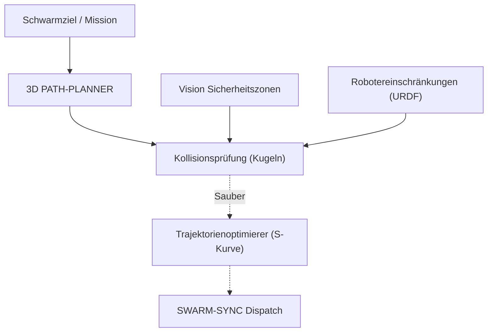

<!-- =============================================================================
HYDRA-UMC-PATH-PLANNER-3D - RRT path planner with collision validation
Copyright (C) JuanenRac (Electro Hobby 3D) <electrohobby3d@gmail.com>
GPL-3.0-or-later - see LICENSE
============================================================================= -->

<p align="center">
  
</p>

# 🗺️ HYDRA-UMC-PATH-PLANNER-3D

<p align="center"><a href="README.md">🇺🇸 English</a> | <a href="README_spa.md">🇪🇸 Español</a> | <a href="README_fra.md">🇫🇷 Français</a> | <a href="README_ita.md">🇮🇹 Italiano</a> | 🇩🇪 <b>Deutsch</b> | <a href="README_zho.md">🇨🇳 简体中文</a> | <a href="README_jpn.md">🇯🇵 日本語</a> | <a href="README_por.md">🇵🇹 Português</a></p>

### 📐 Multi-Roboter 3D-Pfadoptimierer & Kollisionsvermeidung-Engine

<p align="center">
  
  
  
  
  
  
</p>

---

**Ehrlichkeitscheck - was heute wirklich läuft:** die Ein-Agenten-RRT-Suche in `src/rrt.rs` (mit ihrer echten `max_duration_ms`-Uhrzeit-Deadline, unabhängig von `max_iterations`), die Kugel-/Segment-Kollisionsmathematik von `src/obstacle.rs`, die Vektormathematik von `src/geometry.rs`, der deterministische PRNG von `src/rng.rs`, die Szenario-Validierungsschranke von `src/semantics.rs` und die Sicherheits-Nachprüfung eines bereits berechneten Pfads in `src/validate.rs` sind real und getestet (66 Tests, `cargo test`) - jeder zurückgegebene Pfad wird in den Tests als tatsächlich hindernisfrei verifiziert, nicht nur als plausibel. Die CLI (`run.sh scenarios/example.json`, plus der `validate`-Unterbefehl) ist heute wirklich nutzbar. Was noch angestrebt, aber nicht umgesetzt ist: Dies ist ein einfacher Single-Thread-RRT, kein RRT* (im Code existiert kein optimalitätsverbesserender Rewiring-Schritt) und kein Multi-Roboter-Koordinator - die Formulierungen "bis zu 32+ Roboter gleichzeitig" und "Pfadgenerierung in weniger als 50 ms" an anderer Stelle in diesem README beschreiben ein zukünftiges Ziel, kein gemessenes Ergebnis; es gibt nirgendwo in diesem Repository C++-Code (Cargo.toml hat genau zwei Abhängigkeiten, `serde`/`serde_json`, kein Parallelitäts-/Thread-Crate), und es ist eine CLI über eine JSON-Szenariodatei, noch kein Netzwerkdienst, der an HYDRA-UMC-JOB-DISPATCHER angebunden oder gegen ein echtes, laufendes HYDRA-UMC-TWIN validiert ist. Siehe `CHANGELOG.md` für genau das, was bisher ausgeliefert wurde, und `mejoras_futuras.txt` für die vollständige, ehrliche Liste dessen, was bewusst zurückgestellt wurde und warum.

---

> **Stand von Sicherheit (Safety) und Security:** Dieses Ökosystem ist kein zertifiziertes Sicherheitssystem. Es gibt noch keinen Hardware-E-STOP-Pfad, keine von der Firmware durchgesetzten Grenzen oder Verriegelungen und keinen verifizierten Bewegungsbefehl; Firmware-Images werden mit CRC-32 und einer Ed25519-Signatur geprüft, und ein Release-Build verweigert die veröffentlichten Entwicklungsschlüssel (die Werkzeugköpfe und Erweiterungsplatinen hinter dem Relais laufen noch mit URTC-Bootloadern, die statt einer Signatur ein HMAC-SHA256 mit gemeinsamem Schlüssel verwenden); TLS und gegenseitiges TLS sind optional und standardmäßig aus; noch keine eigene Platine wurde bestückt oder getestet. Lesen Sie die [Sicherheitsbasis](https://github.com/JuanenRac/HYDRA-UMC-DOCS/blob/main/docs/SECURITY_BASELINE.md) und das [Bedrohungsmodell](https://github.com/JuanenRac/HYDRA-UMC-DOCS/blob/main/docs/THREAT_MODEL.md), bevor Sie sich für die Sicherheit einer Person auf eine Aussage hier verlassen.

---

## 📋 Auf einen Blick

| | |
|---|---|
| Version | `0.1.1` |
| Reifegrad | Funktionsfähig |
| Tests | 66 (`cargo test`) |
| Technik | Rust / RRT* path planning |
| Auf echter Hardware | Noch nicht: für diese Version ist kein Lauf auf echter Hardware vermerkt |

**Springe zu:** [Überblick](#-überblick) · [Architektur](#-architektur) · [Schnellstart](#-schnellstart) · [Tests](#-tests) · [Struktur des Repositorys](#-struktur-des-repositorys) · [Verwandte Projekte](#-verwandte-projekte)

## 🚦 Projektstatus

Jede Zeile ist ein Teil dieses Repositorys, und die Ampel sagt, wie weit er heute ist. Sie beruht auf dem, was das Repository zeigen kann (Tests, Builds, Läufe), nicht auf dem, was geplant ist.

🟢 Fertig und überprüft · 🟡 Funktioniert, mit bekannten Grenzen · 🟠 Teilweise fertig oder noch nicht überprüft · 🔴 Nicht gemacht oder funktioniert nicht

| Bereich | Stand | Was das hier bedeutet |
|---|---|---|
| Software | 🟡 | Funktioniert für seinen Hauptzweck; die Ehrlichkeitsprüfung oben nennt, was noch fehlt |
| Tests | 🟢 | 66 automatische Tests, bei jeder Änderung ausgeführt |
| Echte Hardware | 🔴 | Noch nicht: für diese Version ist kein Lauf auf echter Hardware vermerkt |
| Dokumentation | 🟢 | README in acht Sprachen, bei jeder Änderung gegen das Manifest geprüft |

## 🎯 Überblick

**HYDRA-UMC-PATH-PLANNER-3D** ist die zentralisierte Navigationsintelligenz für den Roboterschwarm. Es berechnet kollisionsfreie Trajektorien für mehrere Arme, die sich denselben Arbeitsbereich teilen, und optimiert dabei Geschwindigkeit, Energieeffizienz und gleichmäßige Bewegungen.

Es integriert Echtzeit-Belegungsdaten von den Vision-Knoten und kinematische Einschränkungen vom Digital Twin, um sicherzustellen, dass die geplanten Pfade physikalisch machbar und sicher sind.

### Hauptmerkmale:
* 📐 **Ein-Agenten-3D-Pfadsuche (heute real):** eine echte, getestete RRT-Suche über eine statische Szene mit Kugel-Hindernissen (`src/rrt.rs`) - jeder zurückgegebene Pfad wird in den Tests als tatsächlich hindernisfrei verifiziert. Synchrone Planung für 32+ Roboter gleichzeitig ist das Ziel auf Schwarm-Ebene, noch nicht implementiert - siehe ARCHITEKTUR & DESIGNENTSCHEIDUNGEN weiter unten.
* 🛡️ **Pfad-Nachprüfung gegen geänderte Hindernisse (heute real):** der `validate`-Unterbefehl (`src/validate.rs`) prüft einen bereits berechneten Pfad gegen die aktuellen Hindernisse/den Arbeitsbereich eines Szenarios erneut, ohne eine neue Suche. Automatische Echtzeit-Umplanung, ausgelöst durch neu erkannte Hindernisse, ist noch nicht implementiert - heute ist es ein expliziter, separater Befehl, den ein Aufrufer ausführt.
* ⚡ **Deterministische, uhrzeitbeschränkte Suche (heute real):** eine echte Single-Thread-Rust-Implementierung (kein C++ irgendwo in diesem Repository) mit einer echten `PlannerConfig.max_duration_ms`-Deadline, unabhängig von `max_iterations`. Es gibt keine Parallelität und keinen gemessenen Sub-50-ms-Benchmark in diesem Code - Leistungsaussagen dieser Art beschreiben ein zukünftiges Ziel.
* 🔄 **JSON-Szenarioformat (heute real):** ein Szenario ist eine einfache JSON-Datei (`start`/`goal`/`obstacles`/`workspace`/`config`, siehe ERSTELLEN UND AUSFÜHREN weiter unten). Es gibt keinen G-Code- oder URDF-Parser in diesem Repository - das ist Sache von HYDRA-UMC-TWIN, nicht dieses Planers.
* 🧱 **Ehrlich, was geprüft wird (heute real):** Der Arbeitsraum ist das Volumen, in dem der ganze Körper bleiben muss; Start, Ziel, Stichproben und Wegpunkte müssen daher `robot_radius` Abstand zu seinen Wänden halten (ein Arbeitsraum, der schmaler als der Roboter ist, wird abgelehnt); `validate` verlangt außerdem, dass der Pfad am `start` des Szenarios beginnt und an dessen `goal` endet (innerhalb 1e-6), sodass ein zwischengespeicherter Pfad von einer anderen Pose oder ein einzelner Wegpunkt nicht mehr "sicher" ist; `config` darf nur die geänderten Felder auflisten; `max_iterations` ist auf 10.000.000 begrenzt; der Nächste-Nachbar-Baum wird beim Wachsen ausgewogen neu aufgebaut und ohne Rekursion durchlaufen, sodass ein langer gerader Korridor den Stack nicht überlaufen lässt; stdout enthält nur das JSON-Ergebnis (die Identitätszeilen gehen an stderr).

## 🧩 Rolle in HYDRA-UMC

**HYDRA-UMC-PATH-PLANNER-3D** plant einen kollisionsfreien Weg für einen Roboter durch eine Szene mit Kugelhindernissen (RRT-Suche) und prüft einen Weg gegen Hindernisse und Arbeitsraumgrenzen. Es ist eine Rust-Bibliothek und ein Kommandozeilenwerkzeug; für mehrere Roboter gleichzeitig plant es noch nicht.

## 🏛️ Architektur

<p align="center">
  
</p>

<details>
<summary>Textversion des Diagramms (Mermaid)</summary>



</details>

### PLANUNGS-WORKFLOW

> Gepunktete Pfeile sind geplant, nicht umgesetzt: Der Planer liest keine Belegungsdaten und keine Robotereinschränkungen, hat keinen Trajektorienoptimierer und spricht nicht mit SWARM-SYNC. Er plant einen Agenten durch eine statische Menge von Kugeln.

### ARCHITEKTUR & DESIGNENTSCHEIDUNGEN

* **Warum kollisionsfreie 3D-Planung ein eigener Dienst ist.** Die Pfadsuche über eine live 3D-Szene (jeder Roboter, jedes Werkzeug, jedes Hindernis der Zelle) ist CPU-intensiv und latenzsensibel auf eine andere Weise als die Auftragsplanung selbst - sie zu isolieren bedeutet, dass eine langsame Planungsanfrage HYDRA-UMC-JOB-DISPATCHER nie daran hindert, andere Arbeit zuzuweisen.
* **Die Validierung mit HYDRA-UMC-TWIN ist geplant, nicht erledigt.** HYDRA-UMC-TWIN liest heute nur Projektmanifeste: Es hat weder Physik noch Simulation, sodass nichts eine geplante Route auf Drehmomentgrenzen oder Singularitäten prüft, bevor sie an einen echten Arm geht. `validate` prüft Hindernisse, den Arbeitsraum und die beiden Enden des Pfads, nicht mehr.
* **Warum die Suche heute ein einfacher RRT ist, kein RRT\* und kein Multi-Roboter-Koordinator.** `src/rrt.rs` implementiert eine echte, getestete Rapidly-exploring-Random-Tree-Suche - ein einzelner Agent, eine statische Hindernismenge, ein wirklich kollisionsfreies Ergebnis (jede zurückgegebene Route wird in Tests als tatsächlich hindernisfrei verifiziert, nicht nur plausibel aussehend). RRT\* (ein optimalitätsverbessernder Rewiring-Durchlauf) und echte, synchronisierte Multi-Roboter-Planung (die "bis zu 32+ Roboter gleichzeitig" dieses READMEs) sind echte, bewusst ausgeklammerte künftige Arbeit: zuerst wurde die Suche für einen einzelnen Agenten als korrekt bewiesen, statt alle drei gleichzeitig zu bauen und gemeinsam zu debuggen.
* **Warum Hindernisse Kugeln sind, kein Octree beliebiger Meshes.** Eine Kugel ist das einfachste 3D-Kollisionsprimitiv, das trotzdem real und geometrisch korrekt ist - kein Bounding-Box-Ersatz für etwas Detaillierteres. Ein Octree/BVH wird erst relevant, wenn eine Szene genug Kollidierer hat, damit die Brute-Force-Prüfung zum Flaschenhals wird - die heutige Schwarmzelle (eine Handvoll Arme und statische Sicherheitszonen) hat das nicht.
* **Warum dies heute eine CLI über eine JSON-Szenariodatei ist, kein Netzwerkdienst.** Die Wahl zwischen HTTP und dem geteilten gRPC-Vertrag des Ökosystems (`hydra.common.v1`, siehe `HYDRA-UMC-ORCHESTRATOR/proto/`) ist eine echte Protokollentscheidung, die einen eigenen Durchgang verdient, sobald HYDRA-UMC-JOB-DISPATCHER wirklich bereit ist, diesen Dienst aufzurufen. Die CLI ist schon heute wirklich benutzbar (`run.bat scenarios/example.json`), sie ist nur noch nicht ans Netzwerk angeschlossen.
* **Wie sich das ins restliche Ökosystem einfügt.** Ein Geschwisterdienst unter HYDRA-UMC-ORCHESTRATOR - plant die Routen, denen die von HYDRA-UMC-JOB-DISPATCHER zugewiesenen Aufträge tatsächlich folgen, gegengeprüft mit HYDRA-UMC-TWIN, bevor sich real irgendetwas bewegt.
* **Warum `max_duration_ms` eine Prüfung der realen Uhr ist, nicht nur ein niedrigeres `max_iterations`.** Die Iterationsanzahl allein kann die reale Zeit nicht begrenzen: Eine Szene mit dichteren Hindernissen macht die Kollisionsprüfungen jeder Iteration proportional langsamer, sodass dasselbe Iterationsbudget auf einer pathologischen Szene eine völlig andere reale Zeit benötigen kann als auf einer offenen. Ein Planeraufruf in einer Echtzeit-Regelschleife braucht ein echtes Zeitbudget, kein Ersatz dafür.
* **Warum `validate` ein neuer Unterbefehl ist, statt zu ändern, was `plan()` zurückgibt.** `rrt::plan()` gibt bereits nur Pfade zurück, die konstruktionsbedingt kollisionsfrei sind - dort gibt es keine Lücke zu schließen. `validate_path()`/der `validate`-Unterbefehl existiert für Pfade, die NICHT aus einem frischen `plan()`-Aufruf in diesem Prozess stammen: ein zwischengespeicherter/wiedergegebener Pfad, einer, der von einem anderen Prozess weitergeleitet wurde, ein von Hand bearbeitetes Szenario - bei denen sich die Hindernismenge seit der Berechnung des Pfades geändert haben könnte. Dasselbe Muster, das im gesamten Ökosystem verwendet wird: ein neuer, abgesicherter Einstiegspunkt neben einer unveränderten Low-Level-Primitive.

## 🚀 Schnellstart

Benötigt die stabile Rust-Toolchain (Edition 2021) mit `cargo`.

```bash
./build.sh  # Linux, macOS (build.bat on Windows)
./run.sh scenarios/example.json
cargo test
```

## 🧪 Tests

66 automatische Tests laufen mit `cargo test`. Sie brauchen weder Hardware noch etwas außerhalb dieses Rechners.

Die CI führt `HYDRA_UMC_CI=1 python tools/ci_validate.py` aus; das prüft das Manifest, die Dokumente, die acht READMEs und die Bilder.

## 🏗️ Build und Veröffentlichung

Eine echte kollisionsfreie Pfadsuche, nicht nur ein kompilierbares
Skelett: sie plant eine Route anhand einer JSON-Szenariodatei und gibt
das Ergebnis aus.

```bash
# Windows
build.bat
run.bat scenarios/example.json

# Linux / macOS
./build.sh
./run.sh scenarios/example.json
```

`build.sh`/`build.bat` ändern die Version nie (nur `python tools/hydra_project_tool.py bump` erhöht sie) und führen anschließend
`cargo build --release` aus. `run.sh`/`run.bat` führen die resultierende
Binärdatei direkt aus und reichen jedes Argument (den Szenariopfad)
weiter.

Ein Szenario ist eine JSON-Datei mit `start`, `goal`, `obstacles` (eine
Liste von Kugeln `{center, radius}`), einem `workspace` (`min`/`max`-
Grenzen) und optional `seed` (die Suche ist pro Seed vollständig
deterministisch) und `config` (`max_iterations`, `step_size`,
`goal_bias`, `goal_threshold`, `robot_radius`, `max_duration_ms` - alle
optional, sonst mit sinnvollen Standardwerten; `max_duration_ms` begrenzt
die Suchzeit nach der realen Uhr, unabhängig von `max_iterations`). Das
Ergebnis wird als JSON ausgegeben:
`{"status": "ok", "path": [...]}` oder
`{"status": "error", "reason": "..."}` (`start_inside_obstacle`,
`goal_outside_workspace`, `no_path_found`, `time_limit_exceeded` usw. -
siehe `PlanError` in `src/rrt.rs` für die vollständige, ehrliche Liste,
einschließlich des Falls, dass gar keine Route existiert, nicht nur
einer, die die Suche nicht rechtzeitig fand).

Ein optionales `frame` (ein kurzer Name, höchstens 64 Bytes) gibt das Koordinatensystem an, in dem das Szenario geschrieben ist. Es ist nur eine Bezeichnung: Sie wird im Ergebnis wiederholt und ändert nie eine Koordinate.

Ein zweiter echter Unterbefehl prüft einen bereits berechneten Pfad (ein
einfaches JSON-Array von `{x, y, z}`-Wegpunkten) erneut gegen die
aktuellen Hindernisse/den Arbeitsbereich eines Szenarios, ohne eine neue
Suche auszuführen:

```bash
./run.sh validate scenarios/example.json path.json
# {"status": "safe"}
# oder: {"status": "unsafe", "issues": [{"SegmentIntersectsObstacle": {"from_index": 0, "to_index": 1}}]}
```

```bash
cargo test   # Geometrie + Hinderniskollision, den PRNG, den RRT-Planer
             # (einschließlich seines echten Zeitlimits nach der Uhr)
             # und die Sicherheitsnachprüfung von validate.rs -
             # 66 Tests insgesamt
```

## 📂 Struktur des Repositorys

<p align="center">
  
</p>

<details>
<summary>Textversion des Baums</summary>

```text
HYDRA-UMC-PATH-PLANNER-3D/
├── src/                       Quellcode
│   ├── main.rs                CLI-Einstiegspunkt: lädt ein Szenario, plant, gibt JSON aus
│   ├── geometry.rs            Vec3 - die minimale 3D-Vektormathematik, die es braucht
│   ├── obstacle.rs            Kugelhindernisse + Kollisionsprüfungen
│   ├── rng.rs                 Deterministischer, abhängigkeitsfreier PRNG (xorshift64*)
│   ├── rrt.rs                 Der echte Planer: RRT-Suche, Workspace, PlannerConfig
│   ├── validate.rs            Echte Sicherheitsnachprüfung eines bereits berechneten Pfades
│   ├── kdtree.rs              Inkrementeller KD-Baum (beim Wachsen ausgewogen) für den nächsten Nachbarn
│   ├── shrink.rs              Verkleinert ein Szenario, das den Planer an seinem eigenen Validator scheitern lässt
│   ├── semantics.rs           Gemeinsames semantisches Gate: weist ein ungueltiges Szenario vor jeder Geometriepruefung ab
│   └── corpus.rs              Nur für Tests: wiederverwendbare Hindernis-/Workspace-Szenario-
├── tests/                     cli_contract.rs: der Vertrag der Kommandozeile (stdout ist nur das JSON-Ergebnis, eine Teilkonfiguration nutzt Standardwerte, ein Pfad beginnt am Start und endet am Ziel)
├── scenarios/                 JSON-Beispielszenarien
├── docs/                      Dokumente des Projekts
├── images/                    Medien und Diagramme
├── tools/                     Projektwerkzeuge und CI-Prüfungen
├── .github/                   CI-Workflow und Issue-Vorlagen
├── mejoras_futuras.txt        Die vollständige, ehrliche Liste dessen, was bewusst zurückgestellt wurde und warum
├── Cargo.toml                 Rust-Paketmanifest (Name, Version, Abhängigkeiten)
├── bump_version.py            ausdrückliche Versionserhöhung
├── bump_manifest_version.py   Synchronisiert die Version von hydra-umc.project.json mit der nativen (--sync)
├── CHANGELOG.md               was sich in jeder Version geändert hat
├── build-test.sh              Build-Prüfung ohne Änderungen
├── build.sh                   baut und prüft; ändert nie die Version
├── hydra-umc.project.json     Manifest: Version, Reifegrad, Familie
├── run.sh                     startet das Programm
└── test.sh                    führt die Tests aus
```

</details>

## 🗺️ Roadmap und bekannte Grenzen

**Bekannte Grenzen heute**

* **Phase 1:** Deterministische Schwarm-Synchronisation über TSN und Sub-ms-Jitter-Reduzierung.
* **Phase 2:** 3D-Pfadplanung mit dynamischer Hindernisvermeidung in Multi-Roboter-Zellen.
* **Phase 3:** Multi-Roboter-Job-Dispatching-Optimierung unter Berücksichtigung der Ressourcenverfügbarkeit in Echtzeit.
* **Phase 4:** Unterstützung für Pfadplanung mobiler Basen ohne Holonomie (JuanenBOT) und Integration heterogener Flotten.

## 🌍 Sprachen

Diese README und die Dokumente des Repositorys gibt es in acht Sprachen: Englisch, Spanisch, Deutsch, Französisch, Italienisch, Japanisch, Chinesisch und Portugiesisch (Portugal). Sie entstehen gemeinsam, und die CI prüft, dass die acht Dateien dieselben Abschnitte und dieselben Links haben. Dieses Repository hat weder eine eigene Oberfläche noch einen eigenen Meldungskatalog, es gibt also keine Oberflächentexte zu übersetzen.

## 🔗 Verwandte Projekte

Dieses Projekt ist Teil des HYDRA-UMC-Robotik-Ökosystems desselben Autors (JuanenRac / Electro Hobby 3D). Gut zu wissen, da eine Anfrage eigentlich eines dieser Projekte betreffen könnte statt dieses Repositorys.

**Übergeordnetes Projekt**
- **[HYDRA-UMC-ORCHESTRATOR](https://github.com/JuanenRac/HYDRA-UMC-ORCHESTRATOR)** — Integrationsknoten mit einem echten gRPC/Protobuf-Health-Report-Vertrag und einer Missions-Zustandsmaschine; das übergeordnete Projekt, dessen spezifischer Orchestrierungsdienst dieses Repository innerhalb seiner eigenen Schwarmkoordinationsschicht ist.

**Geschwisterprojekte** — die übrigen Orchestrierungsdienste der eigenen Schwarmkoordinationsschicht von HYDRA-UMC-ORCHESTRATOR
- **[HYDRA-UMC-SWARM-SYNC](https://github.com/JuanenRac/HYDRA-UMC-SWARM-SYNC)** — echte CRDT-LWW-Element-Map-Zustandssynchronisation, eigenschaftsgetestet auf Multi-Zellen-Konvergenz.
- **[HYDRA-UMC-JOB-DISPATCHER](https://github.com/JuanenRac/HYDRA-UMC-JOB-DISPATCHER)** — echte prioritätsbasierte Job-Queue mit Deduplizierung, über eine echte HTTP-API.
- **[HYDRA-UMC-NODE-HEALING](https://github.com/JuanenRac/HYDRA-UMC-NODE-HEALING)** — echter gRPC-basierter Flotten-Health-Watchdog mit Retry/Backoff und Identitäts-Mismatch-Erkennung.

**Direkt verwandt**
- **[HYDRA-UMC-TWIN](https://github.com/JuanenRac/HYDRA-UMC-TWIN)** — Integrationsknoten für die Digital-Twin-Engine, mit einem echten Versionskompatibilitäts-Sync-Vertrag — validiert die eigenen geplanten Routen dieses Planers im digitalen Zwilling, bevor sie ausgeführt werden.

**Ebenfalls Teil des Ökosystems**

*Kern-Hardware & Plattform*
- **[HYDRA-UMC](https://github.com/JuanenRac/HYDRA-UMC)** — der Entwurf des Motherboards des Roboterarms: CM5-Host + Dual-Core-STM32H745, gedacht zur Koordination von bis zu 8 Werkzeugarmen über CAN-OTA/SPI-OTA (Firmware in einer frühen Phase; noch keine bestückte Platine).
- **[HYDRA-UMC-OS](https://github.com/JuanenRac/HYDRA-UMC-OS)** — reproduzierbare Raspberry-Pi-OS-Produktschicht für den CM5: schreibgeschützter Agent, validierte Konfiguration/Profile, WiFi-Ersteinrichtung.
- **[HYDRA-UMC-SDK](https://github.com/JuanenRac/HYDRA-UMC-SDK)** — der gemeinsame JSON-Schema-Vertrag und die Software-Auftragsschranke, gegen die jede Bridge ihre Befehle validiert (keine zertifizierte Sicherheitsfunktion).
- **[HYDRA-UMC-CONNECTOR-HUB](https://github.com/JuanenRac/HYDRA-UMC-CONNECTOR-HUB)** — deklaratives Adapter-Manifest-Register und Validator für Konnektoren externer Maschinen; erweitert die eigene Vertragsidee des SDK auf externe Maschinen, ohne die Industrie-Gateway-Projekte zu ersetzen.

*Kern-Backend & Clients*
- **[HYDRA-UMC-SERVER](https://github.com/JuanenRac/HYDRA-UMC-SERVER)** — das reale Headless-Backend (REST/WebSocket), mit dem jeder Steuerungsclient tatsächlich spricht.
- **[HYDRA-UMC-STUDIO](https://github.com/JuanenRac/HYDRA-UMC-STUDIO)** — Web-Steuerungs-Dashboard mit Echtzeit-3D-Visualisierung mehrerer Roboter.
- **[HYDRA-UMC-SUITE](https://github.com/JuanenRac/HYDRA-UMC-SUITE)** — Desktop-Schwarmleitstand (PySide6) für mehrere Server gleichzeitig, verpackt als eigenständige ausführbare Datei.
- **[HYDRA-UMC-ANDROID-CONTROL](https://github.com/JuanenRac/HYDRA-UMC-ANDROID-CONTROL)** — native Android-Steuerungs-App mit biometrischem Login und einer gekoppelten Wear-OS-Begleit-App.
- **[HYDRA-UMC-IOS-CONTROL](https://github.com/JuanenRac/HYDRA-UMC-IOS-CONTROL)** — iOS/iPadOS-Steuerungs-App (Flutter) mit Echtzeit-WebSocket-Synchronisierung.
- **[HYDRA-UMC-DSI](https://github.com/JuanenRac/HYDRA-UMC-DSI)** — native Touch-UI für das eingebaute 7"-DSI-Touchscreen, direkt auf dem CM5 eingebettet.
- **[HYDRA-UMC-EDITOR-URDF](https://github.com/JuanenRac/HYDRA-UMC-EDITOR-URDF)** — grafischer Desktop-URDF-Ersteller/-Editor, der fertige Modelle in STUDIOs eigenen Katalog überträgt.
- **[HYDRA-UMC-EDITOR-STL](https://github.com/JuanenRac/HYDRA-UMC-EDITOR-STL)** — Desktop-STL-Modelleditor, der echte Teile im selben Modellkatalog transformiert/ersetzt/entfernt/hinzufügt, den auch HYDRA-UMC-EDITOR-URDF bearbeitet.
- **[HYDRA-UMC-BRIDGE-AMR](https://github.com/JuanenRac/HYDRA-UMC-BRIDGE-AMR)** — Koordinationsschranke für AGV-/AMR-Flotten über einen VDA-5050-MQTT-Publisher (nur gegen eine emulierte Flotte getestet).
- **[HYDRA-UMC-BRIDGE-CNC](https://github.com/JuanenRac/HYDRA-UMC-BRIDGE-CNC)** — High-Level-Koordinator für CNC-Zellen mit GRBL-Status-/Steuerbyte-Zugriff (nur gegen einen Emulator getestet).
- **[HYDRA-UMC-BRIDGE-DROIDS](https://github.com/JuanenRac/HYDRA-UMC-BRIDGE-DROIDS)** — Koordinationsschranke für laufende/humanoide Droiden, mit einem Boston-Dynamics-Spot-Befehlssender (nur gegen einen Emulator getestet).
- **[HYDRA-UMC-BRIDGE-LASER](https://github.com/JuanenRac/HYDRA-UMC-BRIDGE-LASER)** — Koordinator für Laserzellen, liest 3 Schlüssel-/Gehäuse-/Verriegelungs-GPIO-Signale (nur gegen einen simulierten Chip getestet; kann keinen Laser scharfschalten oder auslösen).
- **[HYDRA-UMC-BRIDGE-OPENPNP](https://github.com/JuanenRac/HYDRA-UMC-BRIDGE-OPENPNP)** — sicherer High-Level-Koordinator für den Leiterplattenfluss von OpenPnP Pick-and-Place.
- **[HYDRA-UMC-BRIDGE-PRINTER3D](https://github.com/JuanenRac/HYDRA-UMC-BRIDGE-PRINTER3D)** — sichere Koordinationsschranke für Moonraker/Klipper-3D-Drucker, mit echten gesicherten Job-Befehlen.
- **[HYDRA-UMC-BRIDGE-ROS2](https://github.com/JuanenRac/HYDRA-UMC-BRIDGE-ROS2)** — Koordinator mit einem träge importierten rclpy-ROS-2-Transport (noch nicht gegen eine ROS-2-Installation ausgeführt).
- **[HYDRA-UMC-BRIDGE-UAV](https://github.com/JuanenRac/HYDRA-UMC-BRIDGE-UAV)** — Koordinationsschranke für kameraausgestattete UAVs, mit einem MAVLink-Befehlssender (nur gegen einen Emulator getestet).

*URTC-Werkzeugplattform*
- **[URTC](https://github.com/JuanenRac/URTC)** — Firmware für die physische Universal-Robot-Tool-Controller-Platine, 25+ Werkzeugprofile über CAN-Bus.
- **[URTC-FLASHER](https://github.com/JuanenRac/URTC-FLASHER)** — Desktop-GUI-Flash-Tool für URTC-Platinen, CAN-OTA plus Full-Chip-SWD/JTAG.
- **[URTC-TESTER](https://github.com/JuanenRac/URTC-TESTER)** — Desktop-Live-CAN-Bus-Diagnosetool für URTC-Platinen, ein Panel pro Werkzeugprofil.
- **[URTC-WEB-STUDIO](https://github.com/JuanenRac/URTC-WEB-STUDIO)** — browserbasierte Alternative zu URTC-TESTER über die Web-Serial-API, ohne lokale Installation.
- **[URTC-GATEWAY](https://github.com/JuanenRac/URTC-GATEWAY)** — Gateway vor dem CAN-Bus von URTC: Liste erlaubter Kennungen, Ratenbegrenzung und Sitzungsschlüssel; Software auf dem Computer getestet, noch nicht an einem echten Bus.

*Vision-KI-Knoten (Hailo-8)*
- **[HYDRA-UMC-VISION-NODE](https://github.com/JuanenRac/HYDRA-UMC-VISION-NODE)** — Integrationsknoten für die Hailo-8-Vision-Pipeline, mit einer echten stufenweisen Hardware-Bereitschaftsprüfung.
- **[HYDRA-UMC-DETECTION-HEF](https://github.com/JuanenRac/HYDRA-UMC-DETECTION-HEF)** — echte Registry für kompilierte Modelle mit Hailo-Architektur-/Prüfsummen-Safe-Load-Verifizierung.
- **[HYDRA-UMC-VISION-STREAMER](https://github.com/JuanenRac/HYDRA-UMC-VISION-STREAMER)** — echter GStreamer-Pipeline- + MediaMTX-Konfigurationsgenerator mit einer echten HailoRT-Integrationsschranke.
- **[HYDRA-UMC-VISUAL-SERVOING-API](https://github.com/JuanenRac/HYDRA-UMC-VISUAL-SERVOING-API)** — Position-Based-Visual-Servoing-Korrekturgesetz mit Freigabe abhängig vom Zonenstatus; noch keine Posenschätzung per Kamera.
- **[HYDRA-UMC-SAFETY-ZONES](https://github.com/JuanenRac/HYDRA-UMC-SAFETY-ZONES)** — v0-Logik für Zonenverletzung, Kalibrierungsaktualität und E-STOP-Anforderung, die Objektpositionen aus einer Datei nimmt; kein Detektor speist sie, und noch kein physischer E-STOP ist angeschlossen.

*Kognitiver KI-Knoten (Hailo-10)*
- **[HYDRA-UMC-COGNITIVE-NODE](https://github.com/JuanenRac/HYDRA-UMC-COGNITIVE-NODE)** — Integrationsknoten für die Hailo-10-Cognitive-Pipeline (LLM-/VLA-/Sprach-Orchestrierung).
- **[HYDRA-UMC-VLA-ENGINE](https://github.com/JuanenRac/HYDRA-UMC-VLA-ENGINE)** — echte Aktions-Token-Kodierung/-Dekodierung und Trajektoriengenerierung für ein Vision-Language-Action-Modell.
- **[HYDRA-UMC-VOICE-UI](https://github.com/JuanenRac/HYDRA-UMC-VOICE-UI)** — echtes Sprach-Frontend (VAD + Intent-Parser) mit einem begrenzten, bestätigungsgesicherten Watch-Relay.
- **[HYDRA-UMC-SEMANTIC-PLANNER](https://github.com/JuanenRac/HYDRA-UMC-SEMANTIC-PLANNER)** — echte regelbasierte Aufgabenzerlegung und semantische Fehlerbehebung über MCU-Fehlercodes.
- **[HYDRA-UMC-DOCS-QA](https://github.com/JuanenRac/HYDRA-UMC-DOCS-QA)** — echte, nur auf der Standardbibliothek basierende TF-IDF-Dokumentensuche über die eigenen Markdown-Dokumente dieses Ökosystems.
- **[HYDRA-UMC-LOCAL-TECHNICIAN](https://github.com/JuanenRac/HYDRA-UMC-LOCAL-TECHNICIAN)** — lokaler, richtlinien-gesteuerter KI-Wartungstechniker für das Ökosystem selbst - beobachtet, diagnostiziert und schlägt Korrekturen vor; die zwei höchsten Risikostufen sind absichtlich noch nicht implementiert.

*Digitaler Zwilling & Simulation*
- **[HYDRA-UMC-HIL-BRIDGE](https://github.com/JuanenRac/HYDRA-UMC-HIL-BRIDGE)** — Hardware-in-the-Loop-Router mit einer Software-Kollisionsverriegelung zwischen Simulation und echter Hardware (ohne echte Hardware getestet).
- **[HYDRA-UMC-PHYSICS-REPLICA](https://github.com/JuanenRac/HYDRA-UMC-PHYSICS-REPLICA)** — echte Vorwärtskinematik und Gelenkgrenzenvalidierung über eine echte URDF-Teilmenge.
- **[HYDRA-UMC-SYNTHETIC-DATA-GEN](https://github.com/JuanenRac/HYDRA-UMC-SYNTHETIC-DATA-GEN)** — echter prozeduraler 2D-Szenengenerator mit YOLO/COCO-Annotationsexport.

*Daten & Analytik*
- **[HYDRA-UMC-DATALAKE](https://github.com/JuanenRac/HYDRA-UMC-DATALAKE)** — echter sqlite3-gestützter Zeitreihenspeicher mit einer echten Ingest-/Abfrage-HTTP-API.
- **[HYDRA-UMC-ANOMALY-DETECTOR](https://github.com/JuanenRac/HYDRA-UMC-ANOMALY-DETECTOR)** — echter FFT- + statistischer Basislinien-Anomaliedetektor mit Drift-Überwachung.
- **[HYDRA-UMC-PRODUCTION-REPORTS](https://github.com/JuanenRac/HYDRA-UMC-PRODUCTION-REPORTS)** — echte OEE-/Verfügbarkeitsberechnung über den DATALAKE-Verlauf, mit reproduzierbarem CSV-Export.
- **[HYDRA-UMC-TELEMETRY-COLLECTOR](https://github.com/JuanenRac/HYDRA-UMC-TELEMETRY-COLLECTOR)** — echte CAN/WebSocket-Ingestion-Pipeline in DATALAKE, mit Sequenz-Deduplizierung.

*Industrie-Gateway*
- **[HYDRA-UMC-GATEWAY-INDUSTRIAL](https://github.com/JuanenRac/HYDRA-UMC-GATEWAY-INDUSTRIAL)** — Integrationsknoten, der zu Industrieprotokollen weiterleitet, mit einer echten Befehls-Allowlist-/Backpressure-Schicht.
- **[HYDRA-UMC-OPCUA-SERVER](https://github.com/JuanenRac/HYDRA-UMC-OPCUA-SERVER)** — echter OPC-UA-Adressraum, verifiziert mit einer echten Binärprotokoll-Client-Session.
- **[HYDRA-UMC-MQTT-BROKER](https://github.com/JuanenRac/HYDRA-UMC-MQTT-BROKER)** — echter MQTT-Broker mit optionaler Pro-Client-Authentifizierung und Topic-ACLs.
- **[HYDRA-UMC-MTCONNECT-ADAPTER](https://github.com/JuanenRac/HYDRA-UMC-MTCONNECT-ADAPTER)** — echte MTConnect-`/probe`- und `/current`-XML-Endpunkte mit Degraded-Mode-Ausgabe.

*Ergänzende Tools & Ökosystembetrieb*
- **[HYDRA-UMC-DASHBOARD-AI](https://github.com/JuanenRac/HYDRA-UMC-DASHBOARD-AI)** — Smart-Summaries- und Anomaly-Highlighting-Panels über DATALAKE/ANOMALY-DETECTOR, mit einem ehrlichen statistischen Fallback.
- **[HYDRA-UMC-TOOL-CLI](https://github.com/JuanenRac/HYDRA-UMC-TOOL-CLI)** — Flotten-CLI mit einem echten, stabilen Exit-Code-Vertrag, ein echter Live-Client der eigenen API von HYDRA-UMC-SERVER.
- **[HYDRA-UMC-WATCH](https://github.com/JuanenRac/HYDRA-UMC-WATCH)** — WearOS-Begleit-App mit haptischen Alarmmustern und einem Sprach-Relay zum gekoppelten Telefon (noch nicht auf einer physischen Uhr ausgeführt).
- **[URTC-SMART-RACK](https://github.com/JuanenRac/URTC-SMART-RACK)** — Firmware für ein Platinenmontagegestell mit echter Werkzeug-ID-Dekodierung und Smart-Idle-Vorheizlogik.
- **[URTC-VISION-TOOL](https://github.com/JuanenRac/URTC-VISION-TOOL)** — Firmware plus ein echter Python-Vision-Begleiter für einen Thermal-/RGB-Inspektionswerkzeugkopf.
- **[HYDRA-UMC-UPDATER](https://github.com/JuanenRac/HYDRA-UMC-UPDATER)** — administratives Desktop-Tool, das jedes Repository in diesem Ökosystem entdeckt, klont und aktualisiert.
- **[HYDRA-UMC-OS-REBUILDER](https://github.com/JuanenRac/HYDRA-UMC-OS-REBUILDER)** — Windows/Linux-Desktop-Tool, das ein flashbereites CM5-Image baut, vorgeladen mit den aktuellsten Versionen des Ökosystems, mit Ersteinrichtungs-Konfiguration für WLAN/Benutzer/SSH im Stil von Raspberry Pi Imager.
- **[HYDRA-UMC-OPS-AGENT](https://github.com/JuanenRac/HYDRA-UMC-OPS-AGENT)** — Wartungsvorfall-Koordinator: eine Edge-Rolle mit niedrigem Privileg sammelt einen bereinigten Inventar-/Gesundheits-Snapshot, eine Control-Plane-Rolle rendert ihn schreibgeschützt und bittet einen KI-Anbieter um einen Diagnosevorschlag - wendet nie einen Patch an und stellt nie etwas bereit.
- **[HYDRA-UMC-DEV-SERVER](https://github.com/JuanenRac/HYDRA-UMC-DEV-SERVER)** — reproduzierbarer Entwicklungshost (Raspberry Pi 5 / CM5), der den Quellcode des Ökosystems vorhält und begrenzte Build-/Test-Aufgaben über eine dauerhafte Warteschlange ausführt; eine dedizierte Entwicklerrolle, ausdrücklich kein operativer CM5.

## 📚 Dokumentation

Hier steht mehr:

* [Sicherheitsgrundlage des Ökosystems](https://github.com/JuanenRac/HYDRA-UMC-DOCS/blob/main/docs/SECURITY_BASELINE.md)
* [Bedrohungsmodell des Ökosystems](https://github.com/JuanenRac/HYDRA-UMC-DOCS/blob/main/docs/THREAT_MODEL.md)
* [Änderungsprotokoll dieses Repositorys](CHANGELOG.md)
* [Lizenz dieses Repositorys](LICENSE.md)

## 🤝 Mitwirken und Community

* Führe vor einem Pull Request `HYDRA_UMC_CI=1 py -3 tools/ci_validate.py` (oder `HYDRA_UMC_CI=1 python3 tools/ci_validate.py`) aus: Es muss `CI_VALIDATION=PASS` ausgeben. Führe dafür nicht `build.sh` oder `build.bat` aus; Bauen ist keine Prüfung.
* Die acht READMEs entstehen aus einer einzigen Quelle in HYDRA-UMC-DOCS; bearbeite sie nicht von Hand. Ändere die Quelle und schreibe sie mit `tools/make_readmes.py` neu.
* Behaupte in einer README nichts, was nicht gelaufen ist: Schreibe „simuliert“ oder „nicht auf Hardware erprobt“, wo das stimmt.
* Siehe [CONTRIBUTING.md](CONTRIBUTING.md), den [Verhaltenskodex](CODE_OF_CONDUCT.md), [SECURITY.md](SECURITY.md) und [SUPPORT.md](SUPPORT.md).

## 👤 AUTOR

**JuanenRac (Electro Hobby 3D)** · electrohobby3d@gmail.com

## 📜 LIZENZ

GPL-3.0-or-later - [LICENSE](LICENSE).
