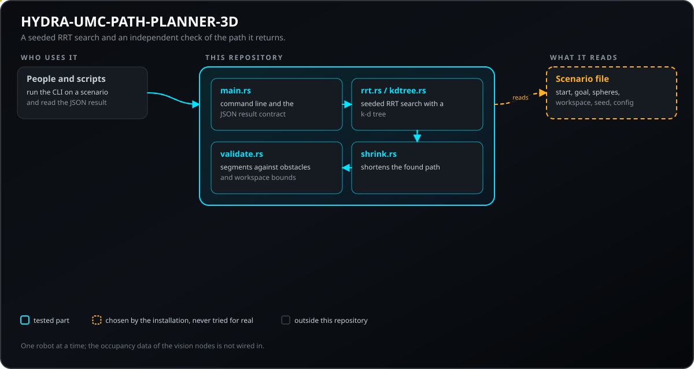
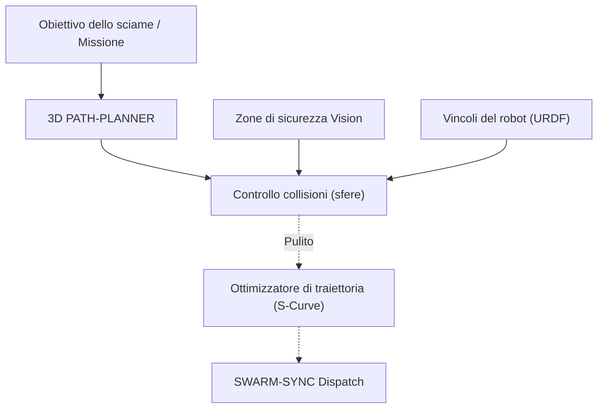
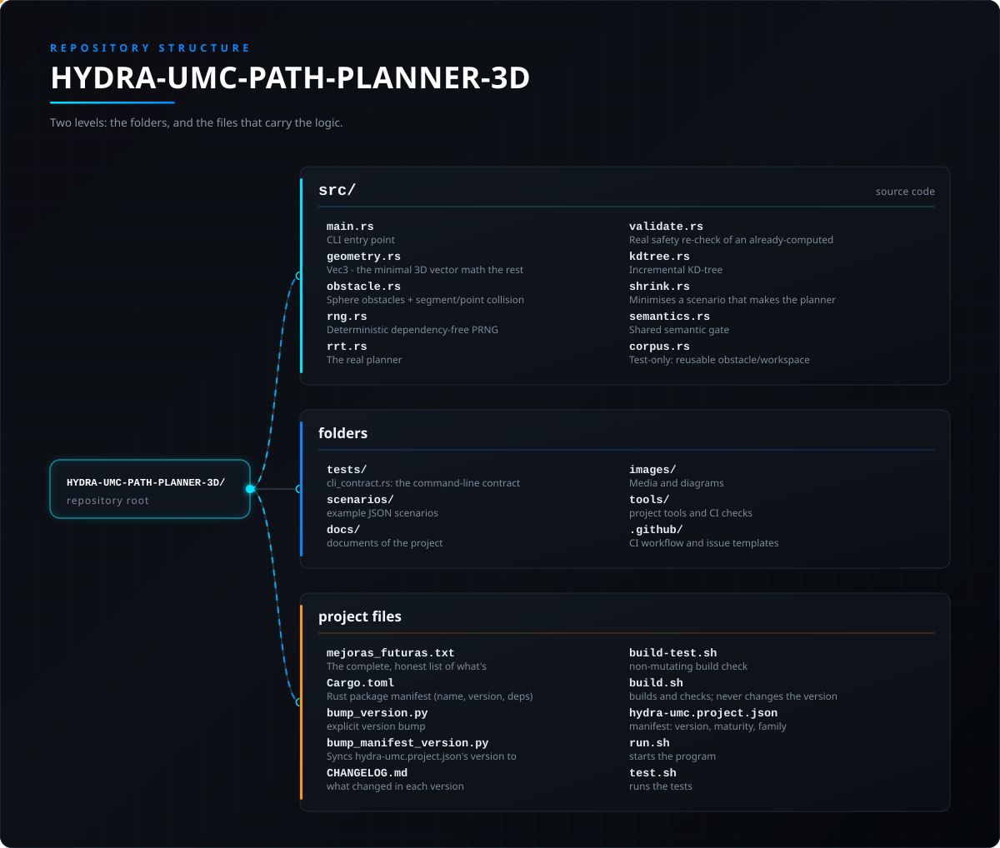

<!-- =============================================================================
HYDRA-UMC-PATH-PLANNER-3D - RRT path planner with collision validation
Copyright (C) JuanenRac (Electro Hobby 3D) <electrohobby3d@gmail.com>
GPL-3.0-or-later - see LICENSE
============================================================================= -->

<p align="center">
  
</p>

# 🗺️ HYDRA-UMC-PATH-PLANNER-3D

<p align="center"><a href="README.md">🇺🇸 English</a> | <a href="README_spa.md">🇪🇸 Español</a> | <a href="README_fra.md">🇫🇷 Français</a> | 🇮🇹 <b>Italiano</b> | <a href="README_deu.md">🇩🇪 Deutsch</a> | <a href="README_zho.md">🇨🇳 简体中文</a> | <a href="README_jpn.md">🇯🇵 日本語</a> | <a href="README_por.md">🇵🇹 Português</a></p>

### 📐 Ottimizzatore di percorsi 3D multi-robot e motore per l'evitamento delle collisioni

<p align="center">
  
  
  
  
  
  
</p>

---

**Verifica di onestà - cosa funziona davvero oggi:** la ricerca RRT a singolo agente in `src/rrt.rs` (con la sua vera scadenza `max_duration_ms` basata sull'orologio reale, indipendente da `max_iterations`), la matematica di collisione sfera/segmento di `src/obstacle.rs`, la matematica vettoriale di `src/geometry.rs`, il PRNG deterministico di `src/rng.rs`, il cancello di validazione degli scenari di `src/semantics.rs`, e la riverifica di sicurezza di un percorso già calcolato in `src/validate.rs` sono reali e testati (66 test, `cargo test`) - ogni percorso restituito è verificato privo di ostacoli nei test, non solo plausibile. La CLI (`run.sh scenarios/example.json`, più il sottocomando `validate`) è davvero utilizzabile oggi. Ciò che resta aspirazionale: questo è un RRT semplice a thread singolo, non un RRT* (nel codice non esiste alcun passaggio di ricollegamento per l'ottimalità) né un coordinatore multi-robot - le espressioni "fino a oltre 32 robot contemporaneamente" e "generazione di percorsi in meno di 50 ms" altrove in questo README descrivono un obiettivo futuro, non un risultato misurato; non c'è alcun C++ in nessuna parte di questo repository (Cargo.toml ha esattamente due dipendenze, `serde`/`serde_json`, nessun crate di parallelismo/thread), ed è una CLI su un file di scenario JSON, non ancora un servizio di rete collegato a HYDRA-UMC-JOB-DISPATCHER né validato contro un HYDRA-UMC-TWIN dal vivo. Vedi `CHANGELOG.md` per ciò che è stato consegnato finora esattamente, e `mejoras_futuras.txt` per l'elenco completo e onesto di ciò che è stato deliberatamente rimandato e perché.

---

> **Stato di sicurezza (safety e security):** questo ecosistema non è un sistema di sicurezza certificato. Non esiste ancora un percorso E-STOP hardware, né limiti o interblocchi imposti dal firmware, né un comando di movimento verificato; le immagini firmware sono controllate con CRC32 e un HMAC-SHA256 a chiave condivisa, non con una firma asimmetrica; TLS e TLS reciproco sono opzionali e disattivati per impostazione predefinita; nessuna scheda propria è stata ancora assemblata o provata. Leggi la [base di sicurezza](https://github.com/JuanenRac/HYDRA-UMC-DOCS/blob/main/docs/SECURITY_BASELINE.md) e il [modello delle minacce](https://github.com/JuanenRac/HYDRA-UMC-DOCS/blob/main/docs/THREAT_MODEL.md) prima di fidarti di qualsiasi affermazione qui per la sicurezza di una persona.

---

## 📋 In breve

| | |
|---|---|
| Versione | `0.1.1` |
| Maturità | Funzionale |
| Test | 66 (`cargo test`) |
| Tecnologia | Rust / RRT* path planning |
| Su hardware reale | Non ancora: per questa versione non risulta alcuna esecuzione su hardware reale |

**Vai a:** [Panoramica](#-panoramica) · [Architettura](#-architettura) · [Avvio rapido](#-avvio-rapido) · [Test](#-test) · [Struttura del repository](#-struttura-del-repository) · [Progetti correlati](#-progetti-correlati)

## 🚦 Stato del progetto

Ogni riga è una parte di questo repository e il semaforo dice a che punto è oggi. È scritta in base a ciò che il repository può mostrare (test, compilazioni, esecuzioni), non a ciò che è previsto.

🟢 Fatto e verificato · 🟡 Funziona, con limiti noti · 🟠 Fatto a metà o non ancora verificato · 🔴 Non fatto o non funzionante

| Area | Stato | Cosa significa qui |
|---|---|---|
| Software | 🟡 | Funziona per il suo scopo principale; la verifica di onestà qui sopra elenca ciò che manca ancora |
| Test | 🟢 | 66 test automatici, eseguiti a ogni modifica |
| Hardware reale | 🔴 | Non ancora: per questa versione non risulta alcuna esecuzione su hardware reale |
| Documentazione | 🟢 | README in otto lingue, verificato rispetto al manifesto a ogni modifica |

## 🎯 Panoramica

**HYDRA-UMC-PATH-PLANNER-3D** è l'intelligenza di navigazione centralizzata per lo sciame di robot. Calcola traiettorie prive di collisioni per più bracci che condividono lo stesso spazio di lavoro, ottimizzando velocità, efficienza energetica e fluidità di movimento.

Integra i dati di occupazione in tempo reale dai Vision Node e i vincoli cinematici dal Digital Twin per garantire che i percorsi pianificati siano fisicamente fattibili e sicuri.

### Caratteristiche principali:
* 📐 **Ricerca di percorso 3D a singolo agente (reale oggi):** una ricerca RRT reale e testata su una scena statica di ostacoli sferici (`src/rrt.rs`) - ogni percorso restituito è verificato privo di ostacoli nei test. La pianificazione sincrona per 32+ robot contemporaneamente è l'obiettivo a livello di sciame, non ancora implementato - vedi ARCHITETTURA E DECISIONI DI PROGETTAZIONE più sotto.
* 🛡️ **Riverifica del percorso contro ostacoli cambiati (reale oggi):** il sottocomando `validate` (`src/validate.rs`) riverifica un percorso già calcolato rispetto agli ostacoli/workspace attuali di uno scenario, senza una nuova ricerca. La ripianificazione automatica in tempo reale attivata da ostacoli appena rilevati non è ancora implementata - oggi è un comando esplicito e separato eseguito da chi chiama.
* ⚡ **Ricerca deterministica limitata dall'orologio reale (reale oggi):** un'implementazione Rust reale a thread singolo (nessun C++ da nessuna parte in questo repository) con una vera scadenza `PlannerConfig.max_duration_ms`, indipendente da `max_iterations`. Non c'è alcun parallelismo né alcun benchmark misurato sotto i 50 ms in questo codice - affermazioni di prestazioni di quel tipo descrivono un obiettivo futuro.
* 🔄 **Formato di scenario JSON (reale oggi):** uno scenario è un semplice file JSON (`start`/`goal`/`obstacles`/`workspace`/`config`, vedi Compilazione e rilascio più sotto). Non esiste alcun parser G-Code o URDF in questo repository - sono compiti propri di HYDRA-UMC-TWIN, non di questo pianificatore.
* 🧱 **Onesto su ciò che controlla (reale oggi):** lo spazio di lavoro è il volume in cui deve restare tutto il corpo, quindi partenza, obiettivo, campioni e punti di passaggio devono mantenere `robot_radius` dalle sue pareti (uno spazio più stretto del robot è rifiutato); `validate` richiede anche che il percorso inizi allo `start` dello scenario e finisca al suo `goal` (entro 1e-6), quindi un percorso in cache da un'altra posa, o un solo punto di passaggio, non è più "sicuro"; `config` può elencare solo i campi che cambia; `max_iterations` è limitato a 10.000.000; l'albero del vicino più prossimo viene ricostruito bilanciato mentre cresce e percorso senza ricorsione, quindi un lungo corridoio dritto non può far traboccare lo stack; stdout porta solo il risultato JSON (le righe di identità vanno su stderr).

## 🧩 Ruolo in HYDRA-UMC

**HYDRA-UMC-PATH-PLANNER-3D** pianifica un percorso senza collisioni per un robot in una scena di ostacoli sferici (ricerca RRT) e verifica un percorso rispetto a ostacoli e limiti dello spazio di lavoro. È una libreria e uno strumento da riga di comando in Rust; non pianifica ancora per più robot insieme.

## 🏛️ Architettura

<p align="center">
  
</p>

<details>
<summary>Versione testuale del diagramma (Mermaid)</summary>



</details>

### WORKFLOW DI PIANIFICAZIONE

> Le frecce tratteggiate sono pianificate, non implementate: il pianificatore non legge dati di occupazione né vincoli del robot, non ha un ottimizzatore di traiettorie e non parla con SWARM-SYNC. Pianifica un agente attraverso un insieme statico di sfere.

### ARCHITETTURA E DECISIONI DI PROGETTAZIONE

* **Perché la pianificazione 3D senza collisioni è un servizio a sé.** La ricerca di percorsi su una scena 3D dal vivo (ogni robot, utensile e ostacolo della cella) è intensiva di CPU e sensibile alla latenza in modo diverso dalla pianificazione dei lavori stessa - isolarla significa che una query di pianificazione lenta non blocca mai HYDRA-UMC-JOB-DISPATCHER nell'assegnare altro lavoro.
* **La validazione con HYDRA-UMC-TWIN è pianificata, non fatta.** HYDRA-UMC-TWIN oggi legge solo manifesti di progetto: non ha fisica né simulazione, quindi nulla controlla un percorso pianificato rispetto a limiti di coppia o singolarità prima che vada a un braccio reale. `validate` controlla ostacoli, spazio di lavoro e le due estremità del percorso, nient'altro.
* **Perché la ricerca è un RRT semplice oggi, non RRT\* né un coordinatore multi-robot.** `src/rrt.rs` implementa una vera ricerca Rapidly-exploring Random Tree, testata - un solo agente, un insieme statico di ostacoli, un risultato genuinamente privo di collisioni (ogni percorso restituito viene verificato libero da ostacoli nei test, non solo plausibile). RRT\* (un passaggio di rewiring che migliora l'ottimalità) e la vera pianificazione multi-robot sincronizzata (i "fino a 32+ robot simultaneamente" di questo README) sono vero lavoro futuro, deliberatamente fuori ambito: dimostrare corretta prima la ricerca a singolo agente è venuto prima, invece di costruire tutte e tre le cose insieme e fare debug insieme.
* **Perché gli ostacoli sono sfere, non un octree di mesh arbitrarie.** Una sfera è il primitivo di collisione 3D più semplice che resta reale e geometricamente corretto - non un sostituto tipo bounding-box di qualcosa di più dettagliato. Un octree/BVH inizia a contare solo quando una scena ha abbastanza collisori da rendere il controllo a forza bruta il collo di bottiglia - la cella dello sciame di oggi (una manciata di bracci e zone di sicurezza statiche) non ce li ha.
* **Perché questa è una CLI su un file di scenario JSON oggi, non un servizio di rete.** Scegliere tra HTTP e il contratto gRPC condiviso dell'ecosistema (`hydra.common.v1`, vedi `HYDRA-UMC-ORCHESTRATOR/proto/`) è una vera decisione di protocollo che merita un proprio passaggio quando HYDRA-UMC-JOB-DISPATCHER sarà realmente pronto a chiamare questo servizio. La CLI è già genuinamente utilizzabile oggi (`run.bat scenarios/example.json`), semplicemente non è ancora collegata alla rete.
* **Come si inserisce nel resto dell'ecosistema.** Un servizio fratello sotto HYDRA-UMC-ORCHESTRATOR - pianifica i percorsi che i lavori assegnati da HYDRA-UMC-JOB-DISPATCHER seguono realmente, verificati incrociando con HYDRA-UMC-TWIN prima che qualcosa si muova per davvero.
* **Perché `max_duration_ms` è un controllo sull'orologio reale, non solo un `max_iterations` più basso.** Il solo numero di iterazioni non può limitare il tempo reale: una scena con ostacoli più densi rende i controlli di collisione di ogni iterazione proporzionalmente più lenti, quindi lo stesso budget di iterazioni può richiedere un tempo reale molto diverso su una scena patologica rispetto a una aperta. Una chiamata al pianificatore all'interno di un ciclo di controllo in tempo reale ha bisogno di un vero budget di tempo, non di un suo sostituto.
* **Perché `validate` è un nuovo sottocomando invece di cambiare ciò che restituisce `plan()`.** `rrt::plan()` restituisce già solo percorsi costruiti privi di collisioni - non c'è nessun divario da colmare li'. `validate_path()`/il sottocomando `validate` esiste per percorsi che NON provengono da una chiamata `plan()` fresca in questo processo: un percorso in cache/riprodotto, uno inoltrato da un altro processo, uno scenario modificato a mano - dove l'insieme di ostacoli potrebbe essere cambiato da quando il percorso è stato calcolato. Lo stesso schema usato in tutto l'ecosistema: un nuovo punto di ingresso con verifica aggiunto accanto a una primitiva di basso livello invariata.

## 🚀 Avvio rapido

Richiede la toolchain Rust stabile (edizione 2021) con `cargo`.

```bash
./build.sh  # Linux, macOS (build.bat on Windows)
./run.sh scenarios/example.json
cargo test
```

## 🧪 Test

66 test automatici si eseguono con `cargo test`. Non richiedono hardware né nulla al di fuori di questa macchina.

La CI esegue `HYDRA_UMC_CI=1 python tools/ci_validate.py`, che controlla il manifesto, i documenti, gli otto README e le immagini.

## 🏗️ Compilazione e rilascio

Una vera ricerca di percorsi privi di collisioni, non solo uno scheletro
che compila: pianifica un percorso a partire da un file di scenario JSON
e stampa il risultato.

```bash
# Windows
build.bat
run.bat scenarios/example.json

# Linux / macOS
./build.sh
./run.sh scenarios/example.json
```

`build.sh`/`build.bat` non cambiano mai la versione (solo `python tools/hydra_project_tool.py bump` la alza) e poi eseguono
`cargo build --release`. `run.sh`/`run.bat` eseguono direttamente il binario
risultante, inoltrando qualsiasi argomento (il percorso dello scenario).

Uno scenario è un file JSON con `start`, `goal`, `obstacles` (una lista
di sfere `{center, radius}`), un `workspace` (limiti `min`/`max`), e
opzionalmente `seed` (la ricerca è totalmente deterministica per seme) e
`config` (`max_iterations`, `step_size`, `goal_bias`, `goal_threshold`,
`robot_radius`, `max_duration_ms` - tutti opzionali, con valori
predefiniti ragionevoli; `max_duration_ms` limita il tempo di ricerca
in base all'orologio reale, indipendentemente da `max_iterations`). Il
risultato viene stampato come JSON: `{"status": "ok", "path": [...]}`
oppure `{"status": "error", "reason": "..."}` (`start_inside_obstacle`,
`goal_outside_workspace`, `no_path_found`, `time_limit_exceeded`, ecc. -
vedi il `PlanError` di `src/rrt.rs` per l'elenco completo e onesto,
incluso il caso in cui semplicemente non esiste alcun percorso, non solo
uno che la ricerca non ha trovato in tempo).

Un `frame` opzionale (un nome breve, al massimo 64 byte) indica il sistema di coordinate in cui è scritto lo scenario. È solo un'etichetta: viene riportata nel risultato e non modifica mai una coordinata.

Un secondo sottocomando reale riverifica un percorso già calcolato (un
semplice array JSON di waypoint `{x, y, z}`) rispetto agli
ostacoli/workspace attuali di uno scenario, senza eseguire una nuova
ricerca:

```bash
./run.sh validate scenarios/example.json path.json
# {"status": "safe"}
# oppure: {"status": "unsafe", "issues": [{"SegmentIntersectsObstacle": {"from_index": 0, "to_index": 1}}]}
```

```bash
cargo test   # geometria + collisione ostacoli, il PRNG, il
             # pianificatore RRT (incluso il suo vero limite di tempo
             # sull'orologio) e la riverifica di sicurezza di validate.rs -
             # 66 test in totale
```

## 📂 Struttura del repository

<p align="center">
  
</p>

<details>
<summary>Versione testuale dell'albero</summary>

```text
HYDRA-UMC-PATH-PLANNER-3D/
├── src/                       codice sorgente
│   ├── main.rs                Punto di ingresso CLI: carica uno scenario, pianifica, stampa JSON
│   ├── geometry.rs            Vec3 - l'algebra vettoriale 3D minima necessaria
│   ├── obstacle.rs            Ostacoli sferici + controlli di collisione
│   ├── rng.rs                 PRNG deterministico senza dipendenze (xorshift64*)
│   ├── rrt.rs                 Il vero pianificatore: ricerca RRT, Workspace, PlannerConfig
│   ├── validate.rs            Riverifica reale di sicurezza di un percorso già calcolato
│   ├── kdtree.rs              KD-tree incrementale (bilanciato mentre cresce) per il vicino più prossimo
│   ├── shrink.rs              Riduce uno scenario che fa fallire il pianificatore sul proprio validatore
│   ├── semantics.rs           Gate semantico condiviso: rifiuta uno scenario non valido prima di qualsiasi controllo geometrico
│   └── corpus.rs              Solo per i test: fixture riutilizzabili di scenari
├── tests/                     cli_contract.rs: il contratto della riga di comando (stdout è solo il risultato JSON, una configurazione parziale usa i valori predefiniti, un percorso inizia dalla partenza e finisce all'obiettivo)
├── scenarios/                 scenari JSON di esempio
├── docs/                      documenti del progetto
├── images/                    Media e diagrammi
├── tools/                     strumenti del progetto e controlli della CI
├── .github/                   workflow di CI e modelli di segnalazione
├── mejoras_futuras.txt        L'elenco completo e onesto di ciò che è deliberatamente rimandato, e perché
├── Cargo.toml                 Manifesto del pacchetto Rust (nome, versione, dep)
├── bump_version.py            Incremento di versione stile contachilometri (eseguito solo dal comando `bump` esplicito)
├── bump_manifest_version.py   Sincronizza la versione di hydra-umc.project.json con quella nativa (--sync)
├── CHANGELOG.md               cosa è cambiato in ogni versione
├── build-test.sh              controllo di build senza modifiche
├── build.sh                   compila e controlla; non cambia mai la versione
├── hydra-umc.project.json     manifesto: versione, maturità, famiglia
├── run.sh                     avvia il programma
└── test.sh                    esegue i test
```

</details>

## 🗺️ Roadmap e limiti noti

**Limiti noti oggi**

* **Fase 1:** Sincronizzazione deterministica dello sciame su TSN e riduzione del jitter sub-ms.
* **Fase 2:** Pianificazione dei percorsi 3D con evitamento dinamico degli ostacoli in celle multi-robot.
* **Fase 3:** Ottimizzazione del dispacciamento dei lavori multi-robot utilizzando la disponibilità delle risorse in tempo reale.
* **Fase 4:** Supporto per la pianificazione del percorso della base mobile non olonoma (JuanenBOT) e integrazione della flotta eterogenea.

## 🌍 Lingue

Questo README e i documenti del repository esistono in otto lingue: inglese, spagnolo, tedesco, francese, italiano, giapponese, cinese e portoghese (Portogallo). Sono scritti insieme e la CI verifica che gli otto file abbiano le stesse sezioni e gli stessi link. Questo repository non ha uno schermo né un catalogo di messaggi propri, quindi non ci sono stringhe di interfaccia da tradurre.

## 🔗 Progetti correlati

Questo progetto fa parte dell'ecosistema robotico HYDRA-UMC dello stesso autore (JuanenRac / Electro Hobby 3D). Vale la pena conoscerlo, poiché una richiesta potrebbe in realtà riguardare uno di questi invece di questo repository.

**Progetto Padre**
- **[HYDRA-UMC-ORCHESTRATOR](https://github.com/JuanenRac/HYDRA-UMC-ORCHESTRATOR)** — hub di integrazione con un vero contratto di health-report gRPC/Protobuf e una macchina a stati di missione; il genitore di cui questo repository è un servizio di orchestrazione specifico, all'interno del proprio livello di coordinamento dello sciame.

**Progetti Fratelli** — gli altri servizi di orchestrazione del livello di coordinamento dello sciame proprio di HYDRA-UMC-ORCHESTRATOR
- **[HYDRA-UMC-SWARM-SYNC](https://github.com/JuanenRac/HYDRA-UMC-SWARM-SYNC)** — vera sincronizzazione di stato CRDT LWW-Element-Map, con property test per la convergenza multi-cella.
- **[HYDRA-UMC-JOB-DISPATCHER](https://github.com/JuanenRac/HYDRA-UMC-JOB-DISPATCHER)** — vera coda di lavori basata su priorità con deduplicazione, su una vera API HTTP.
- **[HYDRA-UMC-NODE-HEALING](https://github.com/JuanenRac/HYDRA-UMC-NODE-HEALING)** — vero watchdog di salute della flotta basato su gRPC, con retry/backoff e rilevamento di discrepanza d'identità.

**Direttamente Correlati**
- **[HYDRA-UMC-TWIN](https://github.com/JuanenRac/HYDRA-UMC-TWIN)** — hub di integrazione per il motore di gemello digitale, con un vero contratto di sincronizzazione per compatibilità di versione — convalida i propri percorsi pianificati da questo planner nel gemello digitale prima che vengano eseguiti.

**Fa Anche Parte dell'Ecosistema**

*Hardware e Piattaforma di Base*
- **[HYDRA-UMC](https://github.com/JuanenRac/HYDRA-UMC)** — il progetto della scheda madre del braccio robotico: host CM5 + coprocessore STM32H745 dual-core, pensato per coordinare fino a 8 bracci utensile via CAN-OTA/SPI-OTA (firmware in fase iniziale; nessuna scheda assemblata per ora).
- **[HYDRA-UMC-OS](https://github.com/JuanenRac/HYDRA-UMC-OS)** — livello prodotto riproducibile su Raspberry Pi OS per il CM5: agente in sola lettura, config/profili validati, provisioning WiFi al primo contatto.
- **[HYDRA-UMC-SDK](https://github.com/JuanenRac/HYDRA-UMC-SDK)** — il contratto JSON-Schema condiviso e la barriera software di controllo dei job contro cui ogni bridge valida i propri comandi (non è una funzione di sicurezza certificata).
- **[HYDRA-UMC-CONNECTOR-HUB](https://github.com/JuanenRac/HYDRA-UMC-CONNECTOR-HUB)** — registro dichiarativo e validatore di manifesti adattatore per connettori di macchine esterne; estende la propria idea di contratto dell'SDK alle macchine esterne senza sostituire i progetti di gateway industriale.

*Backend Centrale e Client*
- **[HYDRA-UMC-SERVER](https://github.com/JuanenRac/HYDRA-UMC-SERVER)** — il vero backend headless (REST/WebSocket) con cui parla davvero ogni client di controllo.
- **[HYDRA-UMC-STUDIO](https://github.com/JuanenRac/HYDRA-UMC-STUDIO)** — dashboard di controllo web con visualizzazione 3D multi-robot in tempo reale.
- **[HYDRA-UMC-SUITE](https://github.com/JuanenRac/HYDRA-UMC-SUITE)** — centro di comando sciame desktop (PySide6) per più server contemporaneamente, pacchettizzato come eseguibile standalone.
- **[HYDRA-UMC-ANDROID-CONTROL](https://github.com/JuanenRac/HYDRA-UMC-ANDROID-CONTROL)** — app di controllo nativa per Android con login biometrico e un companion Wear OS abbinato.
- **[HYDRA-UMC-IOS-CONTROL](https://github.com/JuanenRac/HYDRA-UMC-IOS-CONTROL)** — app di controllo per iOS/iPadOS (Flutter) con sincronizzazione WebSocket in tempo reale.
- **[HYDRA-UMC-DSI](https://github.com/JuanenRac/HYDRA-UMC-DSI)** — interfaccia touch nativa per il touchscreen DSI da 7" a bordo, incorporata direttamente nel CM5.
- **[HYDRA-UMC-EDITOR-URDF](https://github.com/JuanenRac/HYDRA-UMC-EDITOR-URDF)** — creatore/editor grafico desktop di URDF che invia i modelli finiti al catalogo di STUDIO.
- **[HYDRA-UMC-EDITOR-STL](https://github.com/JuanenRac/HYDRA-UMC-EDITOR-STL)** — editor desktop di modelli STL, che trasforma/sostituisce/rimuove/aggiunge veri pezzi nello stesso catalogo di modelli modificato anche da HYDRA-UMC-EDITOR-URDF.
- **[HYDRA-UMC-BRIDGE-AMR](https://github.com/JuanenRac/HYDRA-UMC-BRIDGE-AMR)** — barriera di coordinamento per flotte AGV/AMR tramite un publisher MQTT VDA 5050 (testato solo contro una flotta emulata).
- **[HYDRA-UMC-BRIDGE-CNC](https://github.com/JuanenRac/HYDRA-UMC-BRIDGE-CNC)** — coordinatore ad alto livello per celle CNC con accesso a stato/byte di controllo GRBL (testato solo contro un emulatore).
- **[HYDRA-UMC-BRIDGE-DROIDS](https://github.com/JuanenRac/HYDRA-UMC-BRIDGE-DROIDS)** — barriera di coordinamento per droidi con zampe/umanoidi, con un mittente di comandi per Boston Dynamics Spot (testato solo contro un emulatore).
- **[HYDRA-UMC-BRIDGE-LASER](https://github.com/JuanenRac/HYDRA-UMC-BRIDGE-LASER)** — coordinatore per celle laser che legge 3 segnali GPIO di chiave/involucro/interblocco (testato solo contro un chip simulato; non può armare né far partire un laser).
- **[HYDRA-UMC-BRIDGE-OPENPNP](https://github.com/JuanenRac/HYDRA-UMC-BRIDGE-OPENPNP)** — coordinatore ad alto livello sicuro per il flusso schede del pick-and-place OpenPnP.
- **[HYDRA-UMC-BRIDGE-PRINTER3D](https://github.com/JuanenRac/HYDRA-UMC-BRIDGE-PRINTER3D)** — barriera di coordinamento sicura per stampanti 3D Moonraker/Klipper, con comandi di lavoro reali e controllati.
- **[HYDRA-UMC-BRIDGE-ROS2](https://github.com/JuanenRac/HYDRA-UMC-BRIDGE-ROS2)** — coordinatore con un trasporto ROS 2 rclpy importato in modo lazy (non ancora eseguito contro un'installazione ROS 2).
- **[HYDRA-UMC-BRIDGE-UAV](https://github.com/JuanenRac/HYDRA-UMC-BRIDGE-UAV)** — barriera di coordinamento per UAV dotati di fotocamera, con un mittente di comandi MAVLink (testato solo contro un emulatore).

*Piattaforma Strumenti URTC*
- **[URTC](https://github.com/JuanenRac/URTC)** — firmware per la scheda fisica dell'Universal Robot Tool Controller, oltre 25 profili utensile su bus CAN.
- **[URTC-FLASHER](https://github.com/JuanenRac/URTC-FLASHER)** — strumento desktop con GUI per il flashing delle schede URTC, CAN-OTA più SWD/JTAG a chip intero.
- **[URTC-TESTER](https://github.com/JuanenRac/URTC-TESTER)** — strumento desktop di diagnostica CAN-bus dal vivo per schede URTC, un pannello per profilo utensile.
- **[URTC-WEB-STUDIO](https://github.com/JuanenRac/URTC-WEB-STUDIO)** — alternativa basata su browser a URTC-TESTER tramite la Web Serial API, senza installazione locale.
- **[URTC-GATEWAY](https://github.com/JuanenRac/URTC-GATEWAY)** — gateway davanti al bus CAN di URTC: elenco di identificatori consentiti, limite di frequenza e chiave di sessione; software provato su computer, non ancora su un bus reale.

*Nodo IA Visione (Hailo-8)*
- **[HYDRA-UMC-VISION-NODE](https://github.com/JuanenRac/HYDRA-UMC-VISION-NODE)** — hub di integrazione per la pipeline di visione Hailo-8, con un vero controllo di prontezza hardware per fase.
- **[HYDRA-UMC-DETECTION-HEF](https://github.com/JuanenRac/HYDRA-UMC-DETECTION-HEF)** — registro reale di modelli compilati con verifica di caricamento sicuro per architettura Hailo/checksum.
- **[HYDRA-UMC-VISION-STREAMER](https://github.com/JuanenRac/HYDRA-UMC-VISION-STREAMER)** — generatore reale di pipeline GStreamer + config MediaMTX, con una vera barriera di integrazione HailoRT.
- **[HYDRA-UMC-VISUAL-SERVOING-API](https://github.com/JuanenRac/HYDRA-UMC-VISUAL-SERVOING-API)** — legge di correzione Position-Based Visual Servoing con autorizzazione condizionata allo stato di zona; ancora nessuna stima di posa da telecamera.
- **[HYDRA-UMC-SAFETY-ZONES](https://github.com/JuanenRac/HYDRA-UMC-SAFETY-ZONES)** — logica v0 di violazione zona, freschezza di calibrazione e richiesta E-STOP che legge le posizioni degli oggetti da un file; nessun rilevatore la alimenta e nessun E-STOP fisico è ancora collegato.

*Nodo IA Cognitivo (Hailo-10)*
- **[HYDRA-UMC-COGNITIVE-NODE](https://github.com/JuanenRac/HYDRA-UMC-COGNITIVE-NODE)** — hub di integrazione per la pipeline cognitiva Hailo-10 (orchestrazione LLM/VLA/voce).
- **[HYDRA-UMC-VLA-ENGINE](https://github.com/JuanenRac/HYDRA-UMC-VLA-ENGINE)** — vera codifica/decodifica di token d'azione e generazione di traiettoria per un modello Vision-Language-Action.
- **[HYDRA-UMC-VOICE-UI](https://github.com/JuanenRac/HYDRA-UMC-VOICE-UI)** — vero front-end vocale (VAD + parser di intenti) con un relay verso Watch limitato e soggetto a conferma.
- **[HYDRA-UMC-SEMANTIC-PLANNER](https://github.com/JuanenRac/HYDRA-UMC-SEMANTIC-PLANNER)** — vera scomposizione dei task basata su regole e recupero semantico degli errori sui codici errore MCU.
- **[HYDRA-UMC-DOCS-QA](https://github.com/JuanenRac/HYDRA-UMC-DOCS-QA)** — vera ricerca documentale TF-IDF (solo libreria standard) sui documenti Markdown di questo ecosistema.
- **[HYDRA-UMC-LOCAL-TECHNICIAN](https://github.com/JuanenRac/HYDRA-UMC-LOCAL-TECHNICIAN)** — tecnico di manutenzione IA locale e con cancelli di policy per l'ecosistema stesso - osserva, diagnostica e propone correzioni; i due livelli di rischio più alti non sono deliberatamente ancora implementati.

*Gemello Digitale e Simulazione*
- **[HYDRA-UMC-HIL-BRIDGE](https://github.com/JuanenRac/HYDRA-UMC-HIL-BRIDGE)** — router hardware-in-the-loop con un interblocco software di collisione tra simulazione e hardware reale (testato senza hardware reale).
- **[HYDRA-UMC-PHYSICS-REPLICA](https://github.com/JuanenRac/HYDRA-UMC-PHYSICS-REPLICA)** — vera cinematica diretta e validazione dei limiti articolari su un vero sottoinsieme URDF.
- **[HYDRA-UMC-SYNTHETIC-DATA-GEN](https://github.com/JuanenRac/HYDRA-UMC-SYNTHETIC-DATA-GEN)** — vero generatore procedurale di scene 2D con esportazione di annotazioni YOLO/COCO.

*Dati e Analisi*
- **[HYDRA-UMC-DATALAKE](https://github.com/JuanenRac/HYDRA-UMC-DATALAKE)** — vero archivio di serie temporali basato su sqlite3, con una vera API HTTP di ingestione/query.
- **[HYDRA-UMC-ANOMALY-DETECTOR](https://github.com/JuanenRac/HYDRA-UMC-ANOMALY-DETECTOR)** — vero rilevatore di anomalie FFT + baseline statistica, con monitoraggio della deriva.
- **[HYDRA-UMC-PRODUCTION-REPORTS](https://github.com/JuanenRac/HYDRA-UMC-PRODUCTION-REPORTS)** — vero calcolo OEE/disponibilità sullo storico di DATALAKE, con esportazione CSV riproducibile.
- **[HYDRA-UMC-TELEMETRY-COLLECTOR](https://github.com/JuanenRac/HYDRA-UMC-TELEMETRY-COLLECTOR)** — vera pipeline di ingestione CAN/WebSocket verso DATALAKE, con deduplicazione per sequenza.

*Gateway Industriale*
- **[HYDRA-UMC-GATEWAY-INDUSTRIAL](https://github.com/JuanenRac/HYDRA-UMC-GATEWAY-INDUSTRIAL)** — hub di integrazione che inoltra ai protocolli industriali, con un vero livello di allowlist dei comandi/backpressure.
- **[HYDRA-UMC-OPCUA-SERVER](https://github.com/JuanenRac/HYDRA-UMC-OPCUA-SERVER)** — vero spazio di indirizzi OPC-UA, verificato con una vera sessione client del protocollo binario.
- **[HYDRA-UMC-MQTT-BROKER](https://github.com/JuanenRac/HYDRA-UMC-MQTT-BROKER)** — vero broker MQTT con autenticazione opzionale per client e ACL sui topic.
- **[HYDRA-UMC-MTCONNECT-ADAPTER](https://github.com/JuanenRac/HYDRA-UMC-MTCONNECT-ADAPTER)** — veri endpoint XML `/probe` e `/current` di MTConnect, con output in modalità degradata.

*Strumenti Complementari e Operazioni dell'Ecosistema*
- **[HYDRA-UMC-DASHBOARD-AI](https://github.com/JuanenRac/HYDRA-UMC-DASHBOARD-AI)** — pannelli Smart Summaries e Anomaly Highlighting su DATALAKE/ANOMALY-DETECTOR, con un fallback statistico onesto.
- **[HYDRA-UMC-TOOL-CLI](https://github.com/JuanenRac/HYDRA-UMC-TOOL-CLI)** — CLI di flotta con un vero e stabile contratto di exit-code, un client live reale della stessa API di HYDRA-UMC-SERVER.
- **[HYDRA-UMC-WATCH](https://github.com/JuanenRac/HYDRA-UMC-WATCH)** — app companion WearOS con schemi di avviso aptico e un relay vocale verso il telefono abbinato (non ancora eseguita su un orologio fisico).
- **[URTC-SMART-RACK](https://github.com/JuanenRac/URTC-SMART-RACK)** — firmware per un rack di montaggio schede con decodifica reale dell'ID utensile e logica di preriscaldamento Smart Idle.
- **[URTC-VISION-TOOL](https://github.com/JuanenRac/URTC-VISION-TOOL)** — firmware più un vero companion di visione Python per una testa utensile di ispezione termica/RGB.
- **[HYDRA-UMC-UPDATER](https://github.com/JuanenRac/HYDRA-UMC-UPDATER)** — strumento amministrativo desktop che scopre, clona e aggiorna ogni repository di questo ecosistema.
- **[HYDRA-UMC-OS-REBUILDER](https://github.com/JuanenRac/HYDRA-UMC-OS-REBUILDER)** — strumento desktop Windows/Linux che costruisce un'immagine della CM5 pronta da scrivere, precaricata con le versioni più aggiornate dell'ecosistema, con configurazione di primo avvio Wi-Fi/utente/SSH in stile Raspberry Pi Imager.
- **[HYDRA-UMC-OPS-AGENT](https://github.com/JuanenRac/HYDRA-UMC-OPS-AGENT)** — coordinatore di incidenti di manutenzione: un ruolo edge a basso privilegio raccoglie uno snapshot di inventario/salute sanificato, un ruolo control-plane lo rende in sola lettura e chiede a un provider di IA di suggerire una diagnosi - non applica mai una patch né distribuisce nulla.
- **[HYDRA-UMC-DEV-SERVER](https://github.com/JuanenRac/HYDRA-UMC-DEV-SERVER)** — host di sviluppo riproducibile (Raspberry Pi 5 / CM5) che conserva il codice sorgente dell'ecosistema ed esegue attività delimitate di build/test tramite una coda durevole; un ruolo di sviluppo dedicato, esplicitamente distinto da un CM5 operativo.

## 📚 Documentazione

Dove leggere di più:

* [Base di sicurezza dell'ecosistema](https://github.com/JuanenRac/HYDRA-UMC-DOCS/blob/main/docs/SECURITY_BASELINE.md)
* [Modello delle minacce dell'ecosistema](https://github.com/JuanenRac/HYDRA-UMC-DOCS/blob/main/docs/THREAT_MODEL.md)
* [Registro delle modifiche di questo repository](CHANGELOG.md)
* [Licenza di questo repository](LICENSE.md)

## 🤝 Contribuire e comunità

* Prima di una pull request esegui `HYDRA_UMC_CI=1 py -3 tools/ci_validate.py` (oppure `HYDRA_UMC_CI=1 python3 tools/ci_validate.py`): deve stampare `CI_VALIDATION=PASS`. Non eseguire `build.sh` né `build.bat` per questa verifica; compilare non è verificare.
* I otto README sono scritti da un'unica fonte in HYDRA-UMC-DOCS; non modificarli a mano. Cambia la fonte e riscrivili con `tools/make_readmes.py`.
* Non affermare in un README ciò che non è stato eseguito: scrivi «simulato» o «non provato su hardware» quando è la verità.
* Vedi [CONTRIBUTING.md](CONTRIBUTING.md), il [codice di condotta](CODE_OF_CONDUCT.md), [SECURITY.md](SECURITY.md) e [SUPPORT.md](SUPPORT.md).

## 👤 AUTORE

**JuanenRac (Electro Hobby 3D)** · electrohobby3d@gmail.com

## 📜 LICENZA

GPL-3.0-or-later - [LICENSE](LICENSE).
