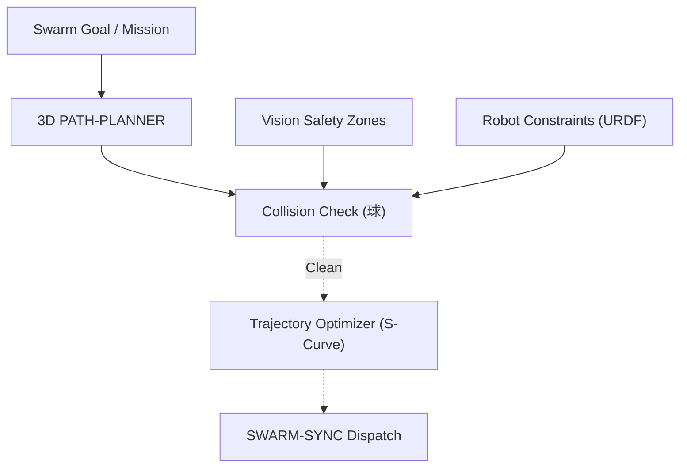

<!-- =============================================================================
HYDRA-UMC-PATH-PLANNER-3D - RRT path planner with collision validation
Copyright (C) JuanenRac (Electro Hobby 3D) <electrohobby3d@gmail.com>
GPL-3.0-or-later - see LICENSE
============================================================================= -->

<p align="center">
  
</p>

# 🗺️ HYDRA-UMC-PATH-PLANNER-3D

<p align="center"><a href="README.md">🇺🇸 English</a> | <a href="README_spa.md">🇪🇸 Español</a> | <a href="README_fra.md">🇫🇷 Français</a> | <a href="README_ita.md">🇮🇹 Italiano</a> | <a href="README_deu.md">🇩🇪 Deutsch</a> | <a href="README_zho.md">🇨🇳 简体中文</a> | 🇯🇵 <b>日本語</b> | <a href="README_por.md">🇵🇹 Português</a></p>

### 📐 マルチロボット 3D パスオプティマイザー & 衝突回避エンジン

<p align="center">
  
  
  
  
  
  
</p>

---

**正直な現状確認 - 実際に今動くもの:** `src/rrt.rs` の単一エージェントRRT探索（`max_iterations`とは独立した、実際の壁時計ベースの `max_duration_ms` 期限を持つ）、`src/obstacle.rs` の球体/線分の衝突計算、`src/geometry.rs` のベクトル計算、`src/rng.rs` の決定論的PRNG、`src/semantics.rs` のシナリオ検証ゲート、そして `src/validate.rs` による既に計算済みの経路の安全性再チェックは本物であり、テスト済みです（56件のテスト、`cargo test`）- 返されるすべての経路は、単に「もっともらしい」だけでなく、テストにおいて実際に障害物のないことが検証されています。CLI（`run.sh scenarios/example.json`、および `validate` サブコマンド）は今日実際に使用可能です。まだ構想段階にとどまっているもの: これは単純なシングルスレッドのRRTであり、RRT*ではありません（コード内に最適性を改善する再配線パスは存在しません）し、マルチロボット・コーディネーターでもありません - このREADMEの他の箇所にある「最大32台以上のロボットを同時に」や「サブ50msでのパス生成」という表現は、将来の目標を述べたものであり、測定された結果ではありません。このリポジトリのどこにもC++は存在せず（Cargo.tomlの依存関係は `serde`/`serde_json` の2つだけで、並列処理/スレッド用クレートはありません）、これは現時点ではJSONシナリオファイルに対するCLIであり、HYDRA-UMC-JOB-DISPATCHERに接続されたネットワークサービスでもなければ、実際に稼働しているHYDRA-UMC-TWINに対して検証されたものでもありません。これまでに実際に出荷されたものの詳細は `CHANGELOG.md` を、意図的に先送りされた事項とその理由の完全で正直な一覧は `mejoras_futuras.txt` を参照してください。

---

> **安全性とセキュリティの現状:** このエコシステムは認証された安全システムではありません。ハードウェアの E-STOP 経路、ファームウェアが強制する制限やインターロック、検証済みの動作コマンドはまだありません。ファームウェアイメージは CRC-32 と Ed25519 署名で検査し、リリースビルドは公開済みの開発用鍵を拒否します(リレーの先のツールヘッドと拡張ボードは引き続き URTC のブートローダーを使い、署名ではなく共有鍵の HMAC-SHA256 を使います)。TLS と相互 TLS は任意で、既定では無効です。独自基板はまだ実装も試験もされていません。ここに書かれた内容を人の安全のために頼る前に、[セキュリティベースライン](https://github.com/JuanenRac/HYDRA-UMC-DOCS/blob/main/docs/SECURITY_BASELINE.md)と[脅威モデル](https://github.com/JuanenRac/HYDRA-UMC-DOCS/blob/main/docs/THREAT_MODEL.md)をお読みください。

---

## 📋 ひと目で

| | |
|---|---|
| バージョン | `0.1.2` |
| 成熟度 | 機能する |
| テスト | 66 (`cargo test`) |
| 技術 | Rust / RRT* path planning |
| 実機での確認 | まだです：このバージョンについて実機での動作記録はありません |

**移動：** [概要](#-概要) · [アーキテクチャ](#-アーキテクチャ) · [クイックスタート](#-クイックスタート) · [テスト](#-テスト) · [リポジトリの構成](#-リポジトリの構成) · [関連プロジェクト](#-関連プロジェクト)

## 🚦 プロジェクトの状況

各行はこのリポジトリの一部分で、信号は今日どこまで進んでいるかを示します。計画ではなく、リポジトリが示せるもの（テスト、ビルド、実行）に基づいて書かれています。

🟢 完了・検証済み · 🟡 動作する（既知の制限あり） · 🟠 一部のみ、または未検証 · 🔴 未実装または動作しない

| 領域 | 状態 | ここでの意味 |
|---|---|---|
| ソフトウェア | 🟡 | 主な目的では動作します。足りない点は上の正直さの確認に書かれています |
| テスト | 🟢 | 自動テスト 66 件。変更のたびに実行されます |
| 実機 | 🔴 | まだです：このバージョンについて実機での動作記録はありません |
| ドキュメント | 🟢 | 8 言語の README。変更のたびにマニフェストと照合されます |

## 🎯 概要

**HYDRA-UMC-PATH-PLANNER-3D** は、ロボットスウォームのための集中型
ナビゲーションインテリジェンスです。同一の作業空間を共有する複数の
アーム向けに衝突のない軌道を計算し、速度、エネルギー効率、そして
スムーズな動作のために最適化します。

ビジョンノードからのリアルタイム占有データと、デジタルツインからの
運動学的制約を統合し、計画されたパスが物理的に実現可能で安全であること
を保証します。

### 主な機能：
* 📐 **単一エージェントによる3Dパス探索（今日実際に動く）：** 静的な球体障害物シーンに対する本物のテスト済みRRT探索（`src/rrt.rs`）- 返されるすべての経路はテストで実際に障害物のないことが検証されています。32台以上のロボットを同時に同期計画することはスウォーム規模での目標であり、まだ実装されていません - 下記のARCHITECTURE & DESIGN DECISIONSを参照してください。
* 🛡️ **変化した障害物に対する経路の再検証（今日実際に動く）：** `validate` サブコマンド（`src/validate.rs`）は、新たな探索を行わずに、既に計算済みの経路をシナリオの現在の障害物/ワークスペースに対して再チェックします。新たに検知された障害物によって自動的にトリガーされるリアルタイム再計画はまだ実装されていません - 現時点では、呼び出し側が実行する明示的で独立したコマンドです。
* ⚡ **決定論的で壁時計により制限された探索（今日実際に動く）：** 本物のシングルスレッドRust実装であり（このリポジトリのどこにもC++は存在しません）、`max_iterations` とは独立した本物の `PlannerConfig.max_duration_ms` 期限を持ちます。このコードには並列処理も、サブ50msの実測ベンチマークも存在しません - その種のパフォーマンスに関する主張は将来の目標を述べたものです。
* 🔄 **JSONシナリオ形式（今日実際に動く）：** シナリオは単純なJSONファイルです（`start`/`goal`/`obstacles`/`workspace`/`config`、詳細は下記のBUILD & RUN GUIDEを参照）。このリポジトリにはG-CodeやURDFのパーサーは存在しません - それらはこのプランナーではなく、HYDRA-UMC-TWIN自身の担当領域です。
* 🧱 **何を検査するかに誠実（現在実装済み）：** ワークスペースは体全体が収まるべき体積なので、始点・目標・サンプル・経由点は壁から `robot_radius` 以上離れていなければなりません（ロボットより狭いワークスペースは拒否されます）。`validate` は経路がシナリオの `start` で始まり `goal` で終わること（1e-6 以内）も要求するため、別の姿勢からのキャッシュ済み経路や単一の経由点はもう「安全」ではありません。`config` は変更するフィールドだけを書けます。`max_iterations` は 10,000,000 が上限です。最近傍ツリーは成長に合わせてバランス良く再構築され、再帰なしで走査されるため、長い直線通路でもスタックはあふれません。stdout には JSON 結果だけが出力されます（識別行は stderr へ）。

## 🧩 HYDRA-UMC での役割

**HYDRA-UMC-PATH-PLANNER-3D** は、球形の障害物がある場面で 1 台のロボットの衝突しない経路を計画し（RRT 探索）、経路を障害物と作業空間の境界に照らして検証します。Rust のライブラリ兼コマンドラインツールで、複数台のロボットを同時に計画することはまだできません。

## 🏛️ アーキテクチャ

<p align="center">
  
</p>

<details>
<summary>図のテキスト版（Mermaid）</summary>



</details>

### プランニングワークフロー

> 点線の矢印は計画中で、未実装です。プランナーは占有データもロボットの制約も読まず、軌道オプティマイザーを持たず、SWARM-SYNC とも通信しません。静的な球の集合の中で 1 つのエージェントを計画するだけです。

### アーキテクチャと設計上の決定

* **3D の衝突のないプランニングが独自のサービスである理由。** ライブの 3D シーン（セル内のすべてのロボット、工具、障害物）に対するパス探索は、ジョブスケジューリング自体とは異なる形で CPU 負荷が高く遅延に敏感です——これを分離することで、遅いプランニングクエリが HYDRA-UMC-JOB-DISPATCHER による他の作業の割当てをブロックすることは決してありません。
* **HYDRA-UMC-TWIN での検証は計画中で、まだ行われていません。** HYDRA-UMC-TWIN は現在プロジェクトのマニフェストを読むだけで、物理もシミュレーションも持たないため、計画された経路が実機のアームに渡る前にトルク限界や特異点を確認するものはありません。`validate` が確認するのは障害物、ワークスペース、経路の両端だけです。
* **探索が今日は単純な RRT であり、RRT* でもマルチロボットコーディネーターでもない理由。** `src/rrt.rs` は実際の、テスト済みの Rapidly-exploring Random Tree 探索を実装しています——単一エージェント、静的障害物集合、本当に衝突のない結果（返されるすべてのパスは、単にもっともらしく見えるだけではなく、テストで実際に障害物がないことが検証されています）。RRT*（最適性を向上させる再接続パス）と、本当の同期されたマルチロボットプランニング（この README の「最大 32+ ロボットを同時に」）は、実際の、意図的に範囲外とした将来の作業です——単一エージェントの探索を正しいと証明することを、3つを同時に構築して一緒にデバッグするよりも先に行いました。
* **障害物が任意のメッシュのオクツリーではなく球体である理由。** 球体は、本当で幾何学的に正しい最も単純な 3D 衝突プリミティブです——より詳細な何かの代わりのバウンディングボックスではありません。オクツリー/BVH が重要になるのは、シーン内の衝突体が十分に多くなり、総総當たり的なチェックがボトルネックになった時だけです——今日のスワームセル（一採りのアームと静的な安全ゾーン）はそこまでには至っていません。
* **これが今日はネットワークサービスではなく JSON シナリオファイル上の CLI である理由。** HTTP とエコシステム共通の gRPC 契約（`hydra.common.v1`、`HYDRA-UMC-ORCHESTRATOR/proto/` 参照）のどちらを選ぶかは、HYDRA-UMC-JOB-DISPATCHER が実際にこのサービスを呼び出す準備ができた時点で独自の検討に値する本当のプロトコル決定です。CLI は今日すでに本当に使えます（`run.bat scenarios/example.json`）。単にまだネットワークに接続されていないだけです。
* **エコシステムの他の部分との関係。** HYDRA-UMC-ORCHESTRATOR の下の兄弟サービスです——HYDRA-UMC-JOB-DISPATCHER が割り当てたジョブが実際に従うルートを計画し、実際に何かが動く前に HYDRA-UMC-TWIN と照合されます。
* **`max_duration_ms` が単に低い `max_iterations` ではなく実時間の壁時計チェックである理由。** イテレーション数だけでは実時間を制限できません——障害物がより密集したシーンでは各イテレーションの衝突判定が比例して遅くなるため、同じイテレーション予算でも病的なシーンと開けたシーンでは実時間が大きく異なる可能性があります。リアルタイム制御ループの中にあるプランナー呼び出しには、その代替物ではなく本物の時間予算が必要です。
* **`validate` が `plan()` の戻り値を変更するのではなく新しいサブコマンドである理由。** `rrt::plan()` はすでに構造上衝突のない経路のみを返します——そこに埋めるべき隙間はありません。`validate_path()`/`validate` サブコマンドは、このプロセス内での新しい `plan()` 呼び出しに由来しない経路——キャッシュされた/再生された経路、別プロセスから中継された経路、手で編集されたシナリオ——のために存在します。これらの場合、経路が計算されて以降に障害物の集合が変わっている可能性があります。エコシステム全体で使われているのと同じパターンです：変更されない低レベルのプリミティブの隣に安全策付きの新しいエントリポイントを追加する。

## 🚀 クイックスタート

安定版の Rust ツールチェーン（エディション 2021）と `cargo` が必要です。

```bash
./build.sh  # Linux, macOS (build.bat on Windows)
./run.sh scenarios/example.json
cargo test
```

## 🧪 テスト

`cargo test` で自動テスト 66 件を実行します。 ハードウェアも、このマシンの外にあるものも必要ありません。

CI は `HYDRA_UMC_CI=1 python tools/ci_validate.py` を実行し、マニフェスト、文書、8 つの README、図を検査します。

## 🏗️ ビルドとリリース

コンパイルできるだけの骨組みではなく、本物の衝突のないパス探索です：
JSON シナリオファイルからルートを計画し、結果を出力します。

```bash
# Windows
build.bat
run.bat scenarios/example.json

# Linux / macOS
./build.sh
./run.sh scenarios/example.json
```

`build.sh`/`build.bat` はバージョンを変更せず（上げるのは `python tools/hydra_project_tool.py bump` だけです）、
その後 `cargo build --release` を実行します。`run.sh`/`run.bat` は
生成されたバイナリを直接実行し、引数（シナリオのパス）をそのまま
渡します。

シナリオは `start`、`goal`、`obstacles`(`{center, radius}` の球体の
リスト)、`workspace`(`min`/`max` の境界)を持つ JSON ファイルで、
オプションで `seed`(探索はシード値ごとに完全に決定論的)と
`config`(`max_iterations`、`step_size`、`goal_bias`、
`goal_threshold`、`robot_radius`、`max_duration_ms` - すべて省略可能で、
省略時は妥当なデフォルト値が使われます。`max_duration_ms` は
`max_iterations` とは独立に、実時間の壁時計で探索時間を制限します)を
指定できます。結果は JSON として出力されます：
`{"status": "ok", "path": [...]}` または
`{"status": "error", "reason": "..."}`(`start_inside_obstacle`、
`goal_outside_workspace`、`no_path_found`、`time_limit_exceeded` など -
完全で正直な一覧は `src/rrt.rs` の `PlanError` を参照。探索が時間内に
見つけられなかっただけでなく、そもそも経路が存在しないケースも
含まれます)。

オプションの `frame`（64 バイト以内の短い名前）は、シナリオが記述されている座標系を示します。これは単なるラベルで、結果にそのまま返され、座標を変更することはありません。

2つ目の実際のサブコマンドは、既に計算済みの経路(`{x, y, z}` の
単純な JSON 配列)を、新しい探索を実行せずに、シナリオの現在の
障害物/ワークスペースに対して再チェックします：

```bash
./run.sh validate scenarios/example.json path.json
# {"status": "safe"}
# または: {"status": "unsafe", "issues": [{"SegmentIntersectsObstacle": {"from_index": 0, "to_index": 1}}]}
```

```bash
cargo test   # 幾何学 + 障害物の衝突判定、PRNG、RRT プランナー自体
             #(その実際の壁時計時間制限を含む)、そして validate.rs の
             # 安全性再チェック - 合計 66 個のテスト
```

## 📂 リポジトリの構成

<p align="center">
  
</p>

<details>
<summary>ツリーのテキスト版</summary>

```text
HYDRA-UMC-PATH-PLANNER-3D/
├── src/                       ソースコード
│   ├── main.rs                CLI エントリポイント：シナリオを読み込み、計画し、JSON を出力
│   ├── geometry.rs            Vec3 - 必要最小限の 3D ベクトル演算
│   ├── obstacle.rs            球形障害物 + 衝突判定
│   ├── rng.rs                 依存関係のない決定論的 PRNG(xorshift64*)
│   ├── rrt.rs                 実際のプランナー：RRT 探索、Workspace、PlannerConfig
│   ├── validate.rs            既に計算済みの経路に対する実際の安全性再チェック
│   ├── kdtree.rs              最近傍探索用の増分 KD ツリー（成長時にバランス再構築）
│   ├── shrink.rs              プランナーが自身のバリデーターで失敗するシナリオを最小化する
│   ├── semantics.rs           共有セマンティックゲート：ジオメトリチェックの前に無効なシナリオを拒否する
│   └── corpus.rs              テスト専用：rrt.rs と validate.rs 自身のテストが共有する
├── tests/                     cli_contract.rs: コマンドラインの契約 (stdout は JSON の結果のみ、部分的な設定は既定値を使う、経路は開始点で始まり目標で終わる)
├── scenarios/                 JSON シナリオの例
├── docs/                      プロジェクトの文書
├── images/                    メディアと図版
├── tools/                     プロジェクトのツールと CI の検査
├── .github/                   CI ワークフローと Issue テンプレート
├── mejoras_futuras.txt        意図的に後回しにした内容とその理由を完全にまとめた正直なリスト
├── Cargo.toml                 Rust パッケージマニフェスト（名前、バージョン、依存関係）
├── bump_version.py            明示的なバージョン更新
├── bump_manifest_version.py   hydra-umc.project.json のバージョンをネイティブ側と同期（--sync）
├── CHANGELOG.md               各バージョンの変更点
├── build-test.sh              変更を伴わないビルド確認
├── build.sh                   ビルドと検査。バージョンは変更しない
├── hydra-umc.project.json     マニフェスト：バージョン、成熟度、ファミリー
├── run.sh                     プログラムを起動
└── test.sh                    テストを実行
```

</details>

## 🗺️ ロードマップと既知の制限

**現時点の既知の制限**

* **フェーズ 1：** TSN による決定論的スウォーム同期とサブミリ秒ジッタの低減。
* **フェーズ 2：** マルチロボットセルにおける動的障害物回避を伴う 3D パスプランニング。
* **フェーズ 3：** リアルタイムのリソース可用性を用いたマルチロボットジョブディスパッチの最適化。
* **フェーズ 4：** 非ホロノミック移動ベース（JuanenBOT）のパスプランニングのサポートと異種フリートの統合。

## 🌍 言語

この README とリポジトリの文書は、英語・スペイン語・ドイツ語・フランス語・イタリア語・日本語・中国語・ポルトガル語（ポルトガル）の 8 言語で提供されています。8 つのファイルは同時に書かれ、同じ節と同じリンクを持つことを CI が確認します。 このリポジトリには独自の画面もメッセージカタログもないため、翻訳すべきインターフェース文字列はありません。

## 🔗 関連プロジェクト

本プロジェクトは、同じ作者(JuanenRac / Electro Hobby 3D)による HYDRA-UMC ロボティクスエコシステムの一部です。リクエストが実はこの中のどれかについてのものである可能性があるため、知っておく価値があります。

**親プロジェクト**
- **[HYDRA-UMC-ORCHESTRATOR](https://github.com/JuanenRac/HYDRA-UMC-ORCHESTRATOR)** — 実際の gRPC/Protobuf ヘルスレポート契約とミッションステートマシンを持つ統合ハブ。本リポジトリは、その自身のスウォーム調整レイヤー内における特定のオーケストレーションサービスとして、この親の一部を成す。

**兄弟プロジェクト** —— HYDRA-UMC-ORCHESTRATOR 自身のスウォーム調整レイヤーにおける他のオーケストレーションサービス
- **[HYDRA-UMC-SWARM-SYNC](https://github.com/JuanenRac/HYDRA-UMC-SWARM-SYNC)** — 複数セルの収束についてプロパティテストされた、実際の CRDT LWW-Element-Map 状態同期。
- **[HYDRA-UMC-JOB-DISPATCHER](https://github.com/JuanenRac/HYDRA-UMC-JOB-DISPATCHER)** — 実際の HTTP API 上に構築された、優先度ベースの実際のジョブキュー(重複排除付き)。
- **[HYDRA-UMC-NODE-HEALING](https://github.com/JuanenRac/HYDRA-UMC-NODE-HEALING)** — リトライ/バックオフとアイデンティティ不一致検出を備えた、実際の gRPC ベースのフリートヘルスウォッチドッグ。

**直接関連**
- **[HYDRA-UMC-TWIN](https://github.com/JuanenRac/HYDRA-UMC-TWIN)** — 実際のバージョン互換性同期契約を持つ、デジタルツインエンジンの統合ハブ ——このプランナー自身が計画したルートを、実行前にデジタルツイン内で検証する。

**エコシステムの他のプロジェクト**

*コアハードウェア&プラットフォーム*
- **[HYDRA-UMC](https://github.com/JuanenRac/HYDRA-UMC)** — ロボットアームのマザーボードの設計——CM5 ホスト + デュアルコア STM32H745、CAN-OTA/SPI-OTA 経由で最大 8 本のツールアームを統括することを目指す(ファームウェアは初期段階で、実装済みの基板はまだない)。
- **[HYDRA-UMC-OS](https://github.com/JuanenRac/HYDRA-UMC-OS)** — CM5 向けの再現可能な Raspberry Pi OS プロダクト層——読み取り専用エージェント、検証済み設定/プロファイル、WiFi 初回接続プロビジョニング。
- **[HYDRA-UMC-SDK](https://github.com/JuanenRac/HYDRA-UMC-SDK)** — すべてのブリッジが自身のコマンドを検証する共有 JSON-Schema 契約とソフトウェアのジョブゲート境界(認証済みの安全機能ではない)。
- **[HYDRA-UMC-CONNECTOR-HUB](https://github.com/JuanenRac/HYDRA-UMC-CONNECTOR-HUB)** — 外部マシン用コネクタのための宣言的アダプターマニフェストのレジストリとバリデーター。SDK 自身の契約という発想を外部マシンにまで拡張し、産業用ゲートウェイ系のプロジェクトを置き換えることはありません。

*コアバックエンド&クライアント*
- **[HYDRA-UMC-SERVER](https://github.com/JuanenRac/HYDRA-UMC-SERVER)** — すべての制御クライアントが実際に通信する、本物のヘッドレスバックエンド(REST/WebSocket)。
- **[HYDRA-UMC-STUDIO](https://github.com/JuanenRac/HYDRA-UMC-STUDIO)** — リアルタイムのマルチロボット 3D 可視化を備えたウェブ制御ダッシュボード。
- **[HYDRA-UMC-SUITE](https://github.com/JuanenRac/HYDRA-UMC-SUITE)** — 複数のサーバーを同時に扱えるデスクトップ(PySide6)スウォームコマンドセンター、スタンドアロン実行ファイルとしてパッケージ化。
- **[HYDRA-UMC-ANDROID-CONTROL](https://github.com/JuanenRac/HYDRA-UMC-ANDROID-CONTROL)** — 生体認証ログインとペアリングされた Wear OS コンパニオンを備えたネイティブ Android 制御アプリ。
- **[HYDRA-UMC-IOS-CONTROL](https://github.com/JuanenRac/HYDRA-UMC-IOS-CONTROL)** — リアルタイム WebSocket 同期を備えた iOS/iPadOS 制御アプリ(Flutter)。
- **[HYDRA-UMC-DSI](https://github.com/JuanenRac/HYDRA-UMC-DSI)** — 本体搭載の 7 インチ DSI タッチスクリーン向けネイティブタッチ UI、CM5 自体に組み込み。
- **[HYDRA-UMC-EDITOR-URDF](https://github.com/JuanenRac/HYDRA-UMC-EDITOR-URDF)** — 完成したモデルを STUDIO 自身のカタログへ送信するデスクトップ用グラフィカル URDF 作成/編集ツール。
- **[HYDRA-UMC-EDITOR-STL](https://github.com/JuanenRac/HYDRA-UMC-EDITOR-STL)** — HYDRA-UMC-EDITOR-URDF も編集する同じモデルカタログ内で、実在するパーツを変換/置換/削除/追加するデスクトップ STL モデルエディタ。
- **[HYDRA-UMC-BRIDGE-AMR](https://github.com/JuanenRac/HYDRA-UMC-BRIDGE-AMR)** — VDA 5050 MQTT パブリッシャーによる AGV/AMR フリートの調整境界(エミュレートしたフリートに対してのみテスト済み)。
- **[HYDRA-UMC-BRIDGE-CNC](https://github.com/JuanenRac/HYDRA-UMC-BRIDGE-CNC)** — GRBL ステータス/制御バイトへのアクセスを持つ、CNC セルの高レベルコーディネーター(エミュレーターに対してのみテスト済み)。
- **[HYDRA-UMC-BRIDGE-DROIDS](https://github.com/JuanenRac/HYDRA-UMC-BRIDGE-DROIDS)** — Boston Dynamics Spot コマンド送信機能を持つ、脚型/ヒューマノイドドロイドの調整境界(エミュレーターに対してのみテスト済み)。
- **[HYDRA-UMC-BRIDGE-LASER](https://github.com/JuanenRac/HYDRA-UMC-BRIDGE-LASER)** — キー/筐体/インターロックの GPIO 信号 3 系統を読み取るレーザーセルのコーディネーター(模擬チップに対してのみテスト済み。レーザーの武装や発射はできない)。
- **[HYDRA-UMC-BRIDGE-OPENPNP](https://github.com/JuanenRac/HYDRA-UMC-BRIDGE-OPENPNP)** — OpenPnP ピックアンドプレースの基板フローを安全に統括する高レベルコーディネーター。
- **[HYDRA-UMC-BRIDGE-PRINTER3D](https://github.com/JuanenRac/HYDRA-UMC-BRIDGE-PRINTER3D)** — 実際にゲート制御されたジョブコマンドを持つ、Moonraker/Klipper 3D プリンター向けの安全な調整境界。
- **[HYDRA-UMC-BRIDGE-ROS2](https://github.com/JuanenRac/HYDRA-UMC-BRIDGE-ROS2)** — 遅延インポートの rclpy ROS 2 トランスポートを持つコーディネーター(ROS 2 環境ではまだ実行していない)。
- **[HYDRA-UMC-BRIDGE-UAV](https://github.com/JuanenRac/HYDRA-UMC-BRIDGE-UAV)** — MAVLink コマンド送信機能を持つ、カメラ搭載 UAV の調整境界(エミュレーターに対してのみテスト済み)。

*URTC ツールプラットフォーム*
- **[URTC](https://github.com/JuanenRac/URTC)** — 物理的な Universal Robot Tool Controller 基板向けファームウェア、CAN バス経由の 25 以上のツールプロファイル。
- **[URTC-FLASHER](https://github.com/JuanenRac/URTC-FLASHER)** — URTC 基板用のデスクトップ GUI 書き込みツール、CAN-OTA およびフルチップ SWD/JTAG。
- **[URTC-TESTER](https://github.com/JuanenRac/URTC-TESTER)** — URTC 基板向けのデスクトップ CAN バスライブ診断ツール、ツールプロファイルごとに 1 パネル。
- **[URTC-WEB-STUDIO](https://github.com/JuanenRac/URTC-WEB-STUDIO)** — Web Serial API を使ったブラウザベースの URTC-TESTER の代替、ローカルインストール不要。
- **[URTC-GATEWAY](https://github.com/JuanenRac/URTC-GATEWAY)** — URTC の CAN バスの前に置くゲートウェイ：許可する識別子のリスト、レート制限、セッション鍵。コンピューター上でテスト済みで、実際のバスではまだ試していません。

*ビジョン AI ノード(Hailo-8)*
- **[HYDRA-UMC-VISION-NODE](https://github.com/JuanenRac/HYDRA-UMC-VISION-NODE)** — Hailo-8 ビジョンパイプラインの統合ハブ、段階ごとの実際のハードウェア準備状況チェック付き。
- **[HYDRA-UMC-DETECTION-HEF](https://github.com/JuanenRac/HYDRA-UMC-DETECTION-HEF)** — Hailo アーキテクチャ/チェックサムによる安全読み込み検証を備えた、実際のコンパイル済みモデルレジストリ。
- **[HYDRA-UMC-VISION-STREAMER](https://github.com/JuanenRac/HYDRA-UMC-VISION-STREAMER)** — 実際の HailoRT 統合境界を持つ、実際の GStreamer パイプライン + MediaMTX 設定生成器。
- **[HYDRA-UMC-VISUAL-SERVOING-API](https://github.com/JuanenRac/HYDRA-UMC-VISUAL-SERVOING-API)** — ゾーン状態を条件に承認する Position-Based Visual Servoing 補正則。カメラによる姿勢推定はまだない。
- **[HYDRA-UMC-SAFETY-ZONES](https://github.com/JuanenRac/HYDRA-UMC-SAFETY-ZONES)** — ファイルから物体位置を受け取る、ゾーン侵入・キャリブレーション鮮度・E-STOP 要求の v0 ロジック。検出器は接続されておらず、物理 E-STOP もまだ配線されていない。

*コグニティブ AI ノード(Hailo-10)*
- **[HYDRA-UMC-COGNITIVE-NODE](https://github.com/JuanenRac/HYDRA-UMC-COGNITIVE-NODE)** — Hailo-10 コグニティブパイプライン(LLM/VLA/音声オーケストレーション)の統合ハブ。
- **[HYDRA-UMC-VLA-ENGINE](https://github.com/JuanenRac/HYDRA-UMC-VLA-ENGINE)** — Vision-Language-Action モデル向けの、実際のアクショントークンのエンコード/デコードと軌道生成。
- **[HYDRA-UMC-VOICE-UI](https://github.com/JuanenRac/HYDRA-UMC-VOICE-UI)** — 確認ゲート付きの限定的な Watch リレーを備えた、実際の音声フロントエンド(VAD + 意図解析)。
- **[HYDRA-UMC-SEMANTIC-PLANNER](https://github.com/JuanenRac/HYDRA-UMC-SEMANTIC-PLANNER)** — MCU エラーコードに対する、実際のルールベースのタスク分解と意味的エラー復旧。
- **[HYDRA-UMC-DOCS-QA](https://github.com/JuanenRac/HYDRA-UMC-DOCS-QA)** — このエコシステム自身の Markdown ドキュメントに対する、標準ライブラリのみの実際の TF-IDF 文書検索。
- **[HYDRA-UMC-LOCAL-TECHNICIAN](https://github.com/JuanenRac/HYDRA-UMC-LOCAL-TECHNICIAN)** — エコシステム自身のための、ローカルでポリシーゲート付きのAIメンテナンス技術者 — 観察、診断し、修正を提案する;最上位の2つのリスクレベルは意図的にまだ実装されていない。

*デジタルツイン&シミュレーション*
- **[HYDRA-UMC-HIL-BRIDGE](https://github.com/JuanenRac/HYDRA-UMC-HIL-BRIDGE)** — シミュレーションと実機の間にソフトウェアの衝突インターロックを備えたハードウェア・イン・ザ・ループのルーター(実機なしでテスト済み)。
- **[HYDRA-UMC-PHYSICS-REPLICA](https://github.com/JuanenRac/HYDRA-UMC-PHYSICS-REPLICA)** — 実際の URDF サブセットに対する、実際の順運動学と関節限界検証。
- **[HYDRA-UMC-SYNTHETIC-DATA-GEN](https://github.com/JuanenRac/HYDRA-UMC-SYNTHETIC-DATA-GEN)** — YOLO/COCO アノテーションのエクスポート機能を持つ、実際のプロシージャル 2D シーンジェネレーター。

*データ&分析*
- **[HYDRA-UMC-DATALAKE](https://github.com/JuanenRac/HYDRA-UMC-DATALAKE)** — 実際の取り込み/クエリ HTTP API を備えた、実際の sqlite3 ベースの時系列ストア。
- **[HYDRA-UMC-ANOMALY-DETECTOR](https://github.com/JuanenRac/HYDRA-UMC-ANOMALY-DETECTOR)** — ドリフト監視を備えた、実際の FFT + 統計ベースラインによる異常検知器。
- **[HYDRA-UMC-PRODUCTION-REPORTS](https://github.com/JuanenRac/HYDRA-UMC-PRODUCTION-REPORTS)** — DATALAKE の履歴に対する実際の OEE/稼働率計算、再現可能な CSV エクスポート付き。
- **[HYDRA-UMC-TELEMETRY-COLLECTOR](https://github.com/JuanenRac/HYDRA-UMC-TELEMETRY-COLLECTOR)** — シーケンス重複排除機能を備えた、DATALAKE への実際の CAN/WebSocket 取り込みパイプライン。

*産業用ゲートウェイ*
- **[HYDRA-UMC-GATEWAY-INDUSTRIAL](https://github.com/JuanenRac/HYDRA-UMC-GATEWAY-INDUSTRIAL)** — 実際のコマンド許可リスト/バックプレッシャー層を持つ、産業用プロトコルへ中継する統合ハブ。
- **[HYDRA-UMC-OPCUA-SERVER](https://github.com/JuanenRac/HYDRA-UMC-OPCUA-SERVER)** — 実際のバイナリプロトコルクライアントセッションで検証された、実際の OPC-UA アドレス空間。
- **[HYDRA-UMC-MQTT-BROKER](https://github.com/JuanenRac/HYDRA-UMC-MQTT-BROKER)** — クライアント単位のオプション認証とトピック ACL を備えた、実際の MQTT ブローカー。
- **[HYDRA-UMC-MTCONNECT-ADAPTER](https://github.com/JuanenRac/HYDRA-UMC-MTCONNECT-ADAPTER)** — 縮退モード出力を備えた、実際の MTConnect `/probe` および `/current` XML エンドポイント。

*補完ツール&エコシステム運用*
- **[HYDRA-UMC-DASHBOARD-AI](https://github.com/JuanenRac/HYDRA-UMC-DASHBOARD-AI)** — 誠実な統計フォールバックを備えた、DATALAKE/ANOMALY-DETECTOR 上のスマートサマリーと異常ハイライトパネル。
- **[HYDRA-UMC-TOOL-CLI](https://github.com/JuanenRac/HYDRA-UMC-TOOL-CLI)** — 実際の安定した終了コード契約を持つフリート CLI、HYDRA-UMC-SERVER 自身の API の本物のライブクライアント。
- **[HYDRA-UMC-WATCH](https://github.com/JuanenRac/HYDRA-UMC-WATCH)** — 触覚アラートのパターンとペアリング済みスマートフォンへの音声リレーを備えた WearOS コンパニオンアプリ(物理的なウォッチではまだ実行していない)。
- **[URTC-SMART-RACK](https://github.com/JuanenRac/URTC-SMART-RACK)** — 実際の工具 ID デコードと Smart Idle 予熱ロジックを備えた、基板搭載ラック用ファームウェア。
- **[URTC-VISION-TOOL](https://github.com/JuanenRac/URTC-VISION-TOOL)** — サーマル/RGB 検査ツールヘッド向けの、ファームウェアと実際の Python ビジョンコンパニオン。
- **[HYDRA-UMC-UPDATER](https://github.com/JuanenRac/HYDRA-UMC-UPDATER)** — このエコシステム内のすべてのリポジトリを検出・クローン・更新する、管理用デスクトップツール。
- **[HYDRA-UMC-OS-REBUILDER](https://github.com/JuanenRac/HYDRA-UMC-OS-REBUILDER)** — エコシステムの最新バージョンをプリロードした、書き込み可能なCM5イメージを構築するWindows/Linuxデスクトップツール。Raspberry Pi Imager方式の初回起動Wi-Fi/ユーザー/SSH設定を備える。
- **[HYDRA-UMC-OPS-AGENT](https://github.com/JuanenRac/HYDRA-UMC-OPS-AGENT)** — 保守インシデントコーディネーター: 低権限のエッジ役割がサニタイズされたインベントリ/ヘルスのスナップショットを収集し、コントロールプレーン役割がそれを読み取り専用でレンダリングして AI プロバイダーに診断の提案を依頼します - パッチを適用することも、何かをデプロイすることも決してありません。
- **[HYDRA-UMC-DEV-SERVER](https://github.com/JuanenRac/HYDRA-UMC-DEV-SERVER)** — 再現可能な開発ホスト（Raspberry Pi 5 / CM5）。エコシステムのソースコードを保管し、永続キューのもとで境界の明確なビルド/テストタスクを実行する。運用中の CM5 とは明確に異なる、開発専用の役割。

## 📚 ドキュメント

さらに読むには：

* [エコシステムのセキュリティ基準](https://github.com/JuanenRac/HYDRA-UMC-DOCS/blob/main/docs/SECURITY_BASELINE.md)
* [エコシステムの脅威モデル](https://github.com/JuanenRac/HYDRA-UMC-DOCS/blob/main/docs/THREAT_MODEL.md)
* [このリポジトリの変更履歴](CHANGELOG.md)
* [このリポジトリのライセンス](LICENSE.md)

## 🤝 コントリビュートとコミュニティ

* プルリクエストの前に `HYDRA_UMC_CI=1 py -3 tools/ci_validate.py`（または `HYDRA_UMC_CI=1 python3 tools/ci_validate.py`）を実行してください。`CI_VALIDATION=PASS` と表示される必要があります。この確認に `build.sh` や `build.bat` は使わないでください。ビルドは検査ではありません。
* 8 つの README は HYDRA-UMC-DOCS の 1 つのソースから書かれます。手で編集しないでください。ソースを変更し、`tools/make_readmes.py` で書き直します。
* 実行していないことを README に書かないでください。事実であれば「シミュレーションのみ」「実機では未確認」と書きます。
* [CONTRIBUTING.md](CONTRIBUTING.md)、[行動規範](CODE_OF_CONDUCT.md)、[SECURITY.md](SECURITY.md)、[SUPPORT.md](SUPPORT.md) を参照してください。

## 👤 作者

**JuanenRac (Electro Hobby 3D)** · electrohobby3d@gmail.com

## 📜 ライセンス

GPL-3.0-or-later - [LICENSE](LICENSE).
