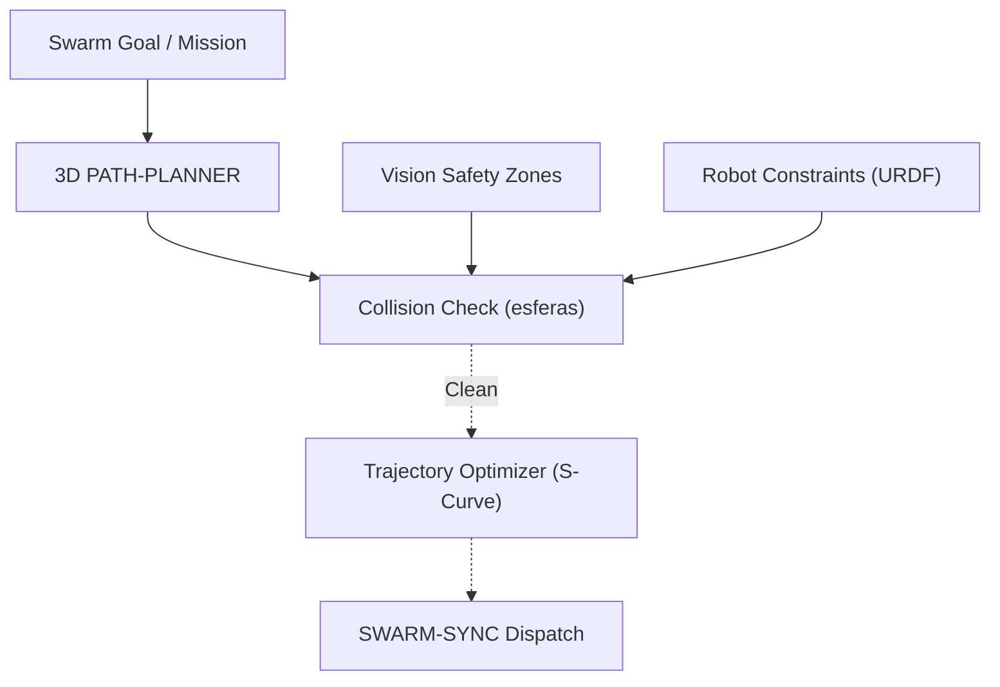

<p align="center">
  
</p>

# 🗺️ HYDRA-UMC-PATH-PLANNER-3D

<p align="center"><a href="README.md">🇺🇸 English</a> | <a href="README_spa.md">🇪🇸 Español</a> | <a href="README_fra.md">🇫🇷 Français</a> | <a href="README_ita.md">🇮🇹 Italiano</a> | <a href="README_deu.md">🇩🇪 Deutsch</a> | <a href="README_zho.md">🇨🇳 简体中文</a> | <a href="README_jpn.md">🇯🇵 日本語</a> | 🇵🇹 <b>Português</b></p>

### 📐 Otimizador de caminhos 3D multirrobô e motor de evitação de colisões

<p align="center">
  
  
  
</p>

---

**Verificação de honestidade - o que realmente funciona hoje:** a pesquisa RRT de um só agente do `src/rrt.rs` (com o seu limite real de tempo de relógio de parede `max_duration_ms`, independente de `max_iterations`), a matemática de colisão esfera/segmento do `src/obstacle.rs`, a matemática vetorial do `src/geometry.rs`, o PRNG determinista do `src/rng.rs`, a porta de validação de cenários do `src/semantics.rs`, a nova verificação de segurança de um caminho já calculado do `src/validate.rs` e a minimização real de casos do `src/shrink.rs` para um cenário que falha (apaga obstáculos e depois aperta o espaço de trabalho/o orçamento de iterações, voltando a verificar exatamente o mesmo predicado de falha após cada redução experimental, nunca um cenário que apenas parece mais pequeno enquanto testa outra coisa) são reais e testados (66 testes, `cargo test`) - cada caminho devolvido é verificado como livre de obstáculos nos testes, e não apenas com ar plausível. A CLI (`run.sh scenarios/example.json`, mais os subcomandos `validate` e `shrink`) é genuinamente utilizável hoje. O que continua a ser aspiracional: isto é um RRT simples de uma só thread, não um RRT* (não existe no código nenhuma passagem de religação para otimalidade) nem um coordenador multirrobô - a linguagem de «até 32+ robôs em simultâneo» e «geração de caminhos em menos de 50 ms» noutros pontos deste README descreve um alvo futuro, não um resultado medido; não há C++ em lado nenhum deste repositório (o Cargo.toml tem exatamente duas dependências, `serde`/`serde_json`, nenhum crate de threads/paralelismo), e é uma CLI sobre um ficheiro de cenário JSON, ainda não um serviço de rede ligado ao HYDRA-UMC-JOB-DISPATCHER nem validado contra um HYDRA-UMC-TWIN em direto. Consulte o `CHANGELOG.md` para saber exatamente o que já foi entregue e o `mejoras_futuras.txt` para a lista completa e honesta do que foi deliberadamente adiado e porquê.

---

> **Estado de segurança (safety e security):** este ecossistema não é um sistema de segurança certificado. Ainda não existe um caminho de E-STOP por hardware, nem limites ou interlocks impostos pelo firmware, nem um comando de movimento verificado; as imagens de firmware são verificadas com CRC32 e um HMAC-SHA256 de chave partilhada, não com uma assinatura assimétrica; TLS e TLS mútuo são opcionais e estão desativados por defeito; nenhuma placa própria foi ainda montada ou testada. Leia a [base de segurança](https://github.com/JuanenRac/HYDRA-UMC-DOCS/blob/main/docs/SECURITY_BASELINE.md) e o [modelo de ameaças](https://github.com/JuanenRac/HYDRA-UMC-DOCS/blob/main/docs/THREAT_MODEL.md) antes de confiar em qualquer afirmação aqui para a segurança de uma pessoa.

## 📋 Num relance

| | |
|---|---|
| Versão | `0.1.1` |
| Maturidade | Funcional |
| Testes | 66 (`cargo test`) |
| Tecnologia | Rust / RRT* path planning |
| Em hardware real | Ainda não: não há registo de execução em hardware real para esta versão |

## 🚦 Estado do projeto

Cada linha é uma parte deste repositório e a luz diz até onde chega hoje. É escrita com o que o repositório consegue demonstrar (testes, compilações, execuções), não com o que está previsto.

🟢 Feito e verificado · 🟡 Funciona, com limites conhecidos · 🟠 Feito a meio ou ainda por verificar · 🔴 Por fazer ou a não funcionar

| Área | Estado | O que significa aqui |
|---|---|---|
| Software | 🟡 | Funciona para o seu propósito principal; a verificação de honestidade acima lista o que ainda falta |
| Testes | 🟢 | 66 testes automáticos, executados a cada alteração |
| Hardware real | 🔴 | Ainda não: não há registo de execução em hardware real para esta versão |
| Documentação | 🟢 | README em oito idiomas, verificado contra o manifesto a cada alteração |

## 1. 🛠️ VISÃO TÉCNICA GERAL

O **HYDRA-UMC-PATH-PLANNER-3D** é a inteligência de navegação centralizada do enxame de robôs. Calcula trajetórias sem colisões para vários braços que partilham o mesmo espaço de trabalho, otimizando a velocidade, a eficiência energética e a suavidade do movimento.

Integra os dados de ocupação em tempo real dos Vision Nodes e as restrições cinemáticas do Digital Twin para garantir que os caminhos planeados são fisicamente exequíveis e seguros.

### Funcionalidades principais:
* 📐 **Pesquisa de caminhos 3D de um só agente (real hoje):** uma pesquisa RRT real e testada sobre uma cena estática de obstáculos esféricos (`src/rrt.rs`) - cada caminho devolvido é verificado como livre de obstáculos nos testes. O planeamento síncrono para 32+ robôs de uma só vez é o objetivo à escala do enxame, ainda não implementado - ver ARQUITETURA E DECISÕES DE DESIGN abaixo.
* 🛡️ **Revalidação de um caminho face a obstáculos alterados (real hoje):** o subcomando `validate` (`src/validate.rs`) volta a verificar um caminho já calculado contra os obstáculos/espaço de trabalho atuais de um cenário, sem uma nova pesquisa. O replaneamento automático em tempo real, desencadeado por obstáculos recém-detetados, ainda não está implementado - hoje é um comando explícito e separado que um chamador executa.
* ⚡ **Pesquisa determinista e limitada pelo relógio de parede (real hoje):** uma implementação Rust pura de uma só thread (sem C++ em lado nenhum deste repositório) com um limite real `PlannerConfig.max_duration_ms`, independente de `max_iterations`. Não há paralelismo nem um benchmark medido abaixo de 50 ms neste código - afirmações de desempenho desse tipo descrevem um alvo futuro.
* 🔄 **Formato de cenário JSON (real hoje):** um cenário é um ficheiro JSON simples (`start`/`goal`/`obstacles`/`workspace`/`config`, ver COMPILAÇÃO E EXECUÇÃO abaixo). Não há nenhum analisador de G-Code nem de URDF neste repositório - isso é preocupação do próprio HYDRA-UMC-TWIN, não deste planeador.
* 🧱 **Honesto sobre o que verifica (real hoje):** o espaço de trabalho é o volume em que todo o corpo tem de ficar, pelo que partida, objetivo, amostras e pontos de passagem têm de manter `robot_radius` de distância às suas paredes (um espaço mais estreito do que o robô é recusado); o `validate` exige ainda que o caminho comece no `start` do cenário e acabe no seu `goal` (a 1e-6), pelo que um caminho em cache de outra pose, ou um único ponto de passagem, já não é "seguro"; o `config` pode listar só os campos que altera; `max_iterations` está limitado a 10 000 000; a árvore do vizinho mais próximo é reconstruída equilibrada à medida que cresce e percorrida sem recursão, pelo que um corredor longo e reto não pode estourar a pilha; o stdout leva só o resultado JSON (as linhas de identidade vão para o stderr).

---

## 2. 🔄 FLUXO DE PLANEAMENTO



> As setas a tracejado estão planeadas, não implementadas: o planeador não lê dados de ocupação nem restrições do robô, não tem otimizador de trajetórias e não fala com o SWARM-SYNC. Planeia um agente através de um conjunto estático de esferas.

---

## 3. 🧱 ARQUITETURA E DECISÕES DE DESIGN

* **Porque é que o planeamento 3D sem colisões é um serviço à parte.** A pesquisa de caminhos sobre uma cena 3D em direto (cada robô, ferramenta e obstáculo da célula) consome muito CPU e é sensível à latência de uma forma diferente do próprio escalonamento de trabalhos - isolá-la significa que uma consulta de planeamento lenta nunca impede o HYDRA-UMC-JOB-DISPATCHER de atribuir outro trabalho.
* **A validação com o HYDRA-UMC-TWIN está planeada, não feita.** O HYDRA-UMC-TWIN hoje só lê manifestos de projeto: não tem física nem simulação, pelo que nada verifica uma rota planeada quanto a limites de binário ou singularidades antes de ir para um braço real. O `validate` verifica obstáculos, o espaço de trabalho e as duas pontas do caminho, nada mais.
* **Porque é que a pesquisa é hoje um RRT simples e não um RRT\* nem um coordenador multirrobô.** O `src/rrt.rs` implementa uma pesquisa real e testada de Rapidly-exploring Random Tree - um só agente, um conjunto estático de obstáculos, um resultado genuinamente sem colisões (cada caminho devolvido é verificado como livre de obstáculos nos testes, e não apenas com ar plausível). O RRT\* (uma passagem de religação que melhora a otimalidade) e o verdadeiro planeamento multirrobô sincronizado («até 32+ robôs em simultâneo» deste README) são trabalho futuro real e delimitado: provar primeiro que a pesquisa de um agente está correta, em vez de construir os três de uma vez e depurá-los em conjunto.
* **Porque é que os obstáculos são esferas e não uma octree de malhas arbitrárias.** Uma esfera é a primitiva de colisão 3D mais simples que continua a ser real e geometricamente correta - não é um substituto de caixa delimitadora para algo mais detalhado. Uma octree/BVH só começa a importar quando uma cena tem colisores suficientes para que a verificação por força bruta seja o gargalo; a célula de enxame de hoje (um punhado de braços e zonas de segurança estáticas) não tem.
* **Porque é que hoje é uma CLI sobre um ficheiro de cenário JSON e não um serviço de rede.** Escolher HTTP ou o contrato gRPC partilhado do ecossistema (`hydra.common.v1`, ver `HYDRA-UMC-ORCHESTRATOR/proto/`) é uma decisão de protocolo real que merece a sua própria passagem quando o HYDRA-UMC-JOB-DISPATCHER estiver de facto pronto para chamar este serviço. A CLI continua a ser genuinamente utilizável hoje (`run.bat scenarios/example.json`), só que ainda não está ligada à rede.
* **Como isto se encaixa no resto do ecossistema.** Um serviço irmão sob o HYDRA-UMC-ORCHESTRATOR - planeia as rotas que os trabalhos atribuídos pelo HYDRA-UMC-JOB-DISPATCHER realmente seguem, confrontadas com o HYDRA-UMC-TWIN antes de algo se mover a sério.
* **Porque é que o `max_duration_ms` é uma verificação de relógio de parede e não apenas um `max_iterations` mais baixo.** Só a contagem de iterações não consegue limitar o tempo real: uma cena com mais obstáculos/mais densos torna as verificações de colisão de cada iteração proporcionalmente mais lentas, pelo que o mesmo orçamento de iterações pode demorar um tempo real muito diferente numa cena patológica face a uma aberta. Uma chamada do planeador dentro de um ciclo de controlo em tempo real precisa de um orçamento de tempo a sério, não de um substituto dele.
* **Porque é que o `validate` é um subcomando novo em vez de mudar o que o `plan()` devolve.** O `rrt::plan()` só devolve caminhos que construiu sem colisões por construção - não há lacuna a fechar aí. O `validate_path()`/subcomando `validate` existe para caminhos que NÃO vieram de uma chamada nova a `plan()` neste processo: um caminho em cache/reproduzido, um retransmitido por outro processo, um cenário editado à mão - em que o conjunto de obstáculos pode ter mudado desde que o caminho foi calculado. O mesmo padrão usado em todo o ecossistema: um ponto de entrada novo e com portas de segurança, acrescentado ao lado de uma primitiva de baixo nível inalterada.

---

## 📂 ESTRUTURA DE DIRETORIAS

```text
HYDRA-UMC-PATH-PLANNER-3D/
├── src/
│   ├── main.rs       # Ponto de entrada da CLI: carrega um cenário, planeia, imprime JSON
│   ├── geometry.rs   # Vec3 - a matemática vetorial 3D mínima de que o resto precisa
│   ├── obstacle.rs   # Obstáculos esféricos + verificações de colisão de segmento/ponto
│   ├── rng.rs        # PRNG determinista sem dependências (xorshift64*)
│   ├── rrt.rs        # O planeador real: pesquisa RRT, Workspace, PlannerConfig
│   ├── validate.rs   # Nova verificação de segurança real de um caminho já calculado
│   ├── kdtree.rs     # KD-tree incremental (equilibrada ao crescer) para o vizinho mais próximo
│   ├── shrink.rs     # Reduz um cenário que faz o planeador falhar no seu próprio validador
│   ├── semantics.rs  # Porta semântica partilhada: rejeita um cenário inválido antes de qualquer verificação geométrica
│   └── corpus.rs     # Só para testes: fixtures reutilizáveis de cenários de obstáculos/espaço de trabalho
│                        partilhadas pelos testes do rrt.rs e do validate.rs
├── scenarios/        # Cenários JSON de exemplo (ver COMPILAÇÃO E EXECUÇÃO abaixo)
├── docs/
│   └── CLI_REFERENCE.md  # Referência das flags da linha de comandos
├── images/           # Multimédia e diagramas
├── tools/
│   └── ci_validate.py   # Validação de manifesto/CHANGELOG/docs usada pelo CI
├── build/            # Binários compilados (saída de build.sh/build.bat)
├── mejoras_futuras.txt  # A lista completa e honesta do que foi deliberadamente adiado e porquê
├── Cargo.toml        # Manifesto do pacote Rust (nome, versão, dependências)
├── bump_version.py   # Subida de versão ao estilo conta-quilómetros (executada só pelo comando `bump` explícito)
├── bump_manifest_version.py  # Sincroniza a versão do hydra-umc.project.json com a nativa (--sync)
├── build.sh/.bat     # Valida e compila (compilar nunca altera a versão)
├── run.sh/.bat       # Executa o binário compilado
└── README.md
```

Retirado do modelo original: `hardware/`, `firmware/` e `os/` — este é um serviço puramente de software (binário Rust), sem hardware nem firmware dedicados e sem imagem de sistema operativo para manter.

---

## 🔧 GUIA DE COMPILAÇÃO E EXECUÇÃO

Uma pesquisa de caminhos sem colisões real, não apenas um esqueleto que compila: planeia uma rota através de um ficheiro de cenário JSON e imprime o resultado.

```bash
# Windows
build.bat
run.bat scenarios/example.json

# Linux / macOS
./build.sh
./run.sh scenarios/example.json
```

`build.sh`/`build.bat` nunca altera a versão (só `python tools/hydra_project_tool.py bump` a sobe) e depois executa `cargo build --release`. O `run.sh`/`run.bat` executa diretamente o binário resultante, reencaminhando para ele quaisquer argumentos (o caminho do cenário).

Um cenário é um ficheiro JSON com `start`, `goal`, `obstacles` (uma lista de esferas `{center, radius}`), um `workspace` (limites `min`/`max`) e, opcionalmente, um `seed` (a pesquisa é totalmente determinista por semente) e um `config` (`max_iterations`, `step_size`, `goal_bias`, `goal_threshold`, `robot_radius`, `max_duration_ms` - todos opcionais, com valores por defeito sensatos; o `max_duration_ms` limita o tempo de pesquisa pelo relógio de parede, independentemente de `max_iterations`). O resultado é impresso como JSON: `{"status": "ok", "path": [...]}` ou `{"status": "error", "reason": "..."}` (`start_inside_obstacle`, `goal_outside_workspace`, `no_path_found`, `time_limit_exceeded`, etc. - ver o `PlanError` do `src/rrt.rs` para a lista completa e honesta, incluindo o caso em que não existe caminho nenhum, e não apenas um que a pesquisa não encontrou a tempo).

Um `frame` opcional (um nome curto, no máximo 64 bytes) regista o referencial de coordenadas em que o cenário está escrito. É apenas uma etiqueta: é devolvido no resultado e nunca altera nenhuma coordenada.

Um segundo subcomando real volta a verificar a segurança de um caminho já calculado (um array JSON simples de pontos `{x, y, z}`) face aos obstáculos/espaço de trabalho atuais de um cenário, sem executar uma nova pesquisa:

```bash
./run.sh validate scenarios/example.json path.json
# {"status": "safe"}
# or: {"status": "unsafe", "issues": [{"SegmentIntersectsObstacle": {"from_index": 0, "to_index": 1}}]}
```

```bash
cargo test   # matemática de geometria + colisão de obstáculos, o PRNG, o
             # planeador RRT (incluindo o seu limite real de tempo de relógio
             # de parede), a nova verificação de segurança do próprio
             # validate.rs e a minimização real de cenários que falham do
             # shrink.rs - 66 testes no total
```

---

## 🚀 ROTEIRO
* **Fase 1:** Sincronização determinista do enxame sobre TSN e redução de jitter abaixo do milissegundo.
* **Fase 2:** Planeamento de caminhos 3D com evitação dinâmica de obstáculos em células multirrobô.
* **Fase 3:** Otimização do despacho de trabalhos multirrobô com a disponibilidade de recursos em tempo real.
* **Fase 4:** Suporte ao planeamento de caminhos de bases móveis não holonómicas (JuanenBOT) e integração de frotas heterogéneas.

---

## 🔗 Projetos relacionados

Este projeto faz parte do ecossistema de robótica HYDRA-UMC do mesmo autor (JuanenRac / Electro Hobby 3D). Vale a pena conhecê-los, porque um pedido pode ser, na verdade, sobre um destes e não sobre este repositório.

**Projeto-mãe**
- **[HYDRA-UMC-ORCHESTRATOR](https://github.com/JuanenRac/HYDRA-UMC-ORCHESTRATOR)** — hub de integração com um contrato real gRPC/Protobuf de relatórios de saúde e uma máquina de estados de missões; o pai de que este repositório é um serviço de orquestração específico, dentro da sua própria camada de coordenação de enxame.

**Projetos irmãos** — os outros serviços de orquestração da própria camada de coordenação de enxame do HYDRA-UMC-ORCHESTRATOR
- **[HYDRA-UMC-SWARM-SYNC](https://github.com/JuanenRac/HYDRA-UMC-SWARM-SYNC)** — sincronização real de estado CRDT LWW-Element-Map, testada por propriedades para a convergência de várias células.
- **[HYDRA-UMC-JOB-DISPATCHER](https://github.com/JuanenRac/HYDRA-UMC-JOB-DISPATCHER)** — fila real de trabalhos por prioridade com deduplicação, sobre uma API HTTP real.
- **[HYDRA-UMC-NODE-HEALING](https://github.com/JuanenRac/HYDRA-UMC-NODE-HEALING)** — vigilante real de saúde da frota por gRPC com repetição/recuo e deteção de identidade incoerente.

**Diretamente relacionados**
- **[HYDRA-UMC-TWIN](https://github.com/JuanenRac/HYDRA-UMC-TWIN)** — hub de integração do motor de gémeo digital, com um contrato real de sincronização por compatibilidade de versões — valida as rotas planeadas por este planeador no gémeo digital antes de serem executadas.

**Também fazem parte do ecossistema**

*Hardware e plataforma centrais*
- **[HYDRA-UMC](https://github.com/JuanenRac/HYDRA-UMC)** — o desenho da placa-mãe do braço robótico: anfitrião CM5 + STM32H745 de dois núcleos, pensado para orquestrar até 8 braços de ferramenta por CAN-OTA/SPI-OTA (firmware numa fase inicial; ainda sem placa montada).
- **[HYDRA-UMC-OS](https://github.com/JuanenRac/HYDRA-UMC-OS)** — camada de produto reproduzível do Raspberry Pi OS para o CM5: agente só de leitura, configuração/perfis validados, aprovisionamento Wi-Fi de primeiro contacto.
- **[HYDRA-UMC-SDK](https://github.com/JuanenRac/HYDRA-UMC-SDK)** — o contrato JSON-Schema partilhado e a fronteira de software de controlo de trabalhos contra a qual cada bridge valida os seus comandos (não é uma função de segurança certificada).
- **[HYDRA-UMC-CONNECTOR-HUB](https://github.com/JuanenRac/HYDRA-UMC-CONNECTOR-HUB)** — registo declarativo de manifestos de adaptador e validador para conectores de máquinas externas; estende a ideia de contrato do SDK a máquinas externas sem substituir os projetos de gateway industrial.

*Backend central e clientes*
- **[HYDRA-UMC-SERVER](https://github.com/JuanenRac/HYDRA-UMC-SERVER)** — o back-end headless real (REST/WebSocket) com que todos os clientes de controlo realmente comunicam.
- **[HYDRA-UMC-STUDIO](https://github.com/JuanenRac/HYDRA-UMC-STUDIO)** — painel web de controlo com visualização 3D em tempo real de vários robôs.
- **[HYDRA-UMC-SUITE](https://github.com/JuanenRac/HYDRA-UMC-SUITE)** — centro de comando de enxame para desktop (PySide6) para vários servidores ao mesmo tempo, empacotado como executável independente.
- **[HYDRA-UMC-ANDROID-CONTROL](https://github.com/JuanenRac/HYDRA-UMC-ANDROID-CONTROL)** — aplicação Android nativa de controlo, com início de sessão biométrico e um companheiro Wear OS emparelhado.
- **[HYDRA-UMC-IOS-CONTROL](https://github.com/JuanenRac/HYDRA-UMC-IOS-CONTROL)** — aplicação de controlo para iOS/iPadOS (Flutter) com sincronização WebSocket em tempo real.
- **[HYDRA-UMC-DSI](https://github.com/JuanenRac/HYDRA-UMC-DSI)** — interface tátil nativa para o ecrã tátil DSI de 7" integrado, executada no próprio CM5.
- **[HYDRA-UMC-EDITOR-URDF](https://github.com/JuanenRac/HYDRA-UMC-EDITOR-URDF)** — criador/editor gráfico de URDF para desktop que envia os modelos concluídos para o catálogo do STUDIO.
- **[HYDRA-UMC-EDITOR-STL](https://github.com/JuanenRac/HYDRA-UMC-EDITOR-STL)** — editor de modelos STL para desktop que transforma/substitui/remove/adiciona peças reais no mesmo catálogo de modelos que o HYDRA-UMC-EDITOR-URDF também edita.
- **[HYDRA-UMC-BRIDGE-AMR](https://github.com/JuanenRac/HYDRA-UMC-BRIDGE-AMR)** — fronteira de coordenação para frotas AGV/AMR através de um publicador MQTT VDA 5050 (testado apenas contra uma frota emulada).
- **[HYDRA-UMC-BRIDGE-CNC](https://github.com/JuanenRac/HYDRA-UMC-BRIDGE-CNC)** — coordenador de células CNC de alto nível com acesso ao estado GRBL e aos bytes de controlo (testado apenas contra um emulador).
- **[HYDRA-UMC-BRIDGE-DROIDS](https://github.com/JuanenRac/HYDRA-UMC-BRIDGE-DROIDS)** — fronteira de coordenação para droides com patas/humanoides, com um emissor de comandos para o Boston Dynamics Spot (testado apenas contra um emulador).
- **[HYDRA-UMC-BRIDGE-LASER](https://github.com/JuanenRac/HYDRA-UMC-BRIDGE-LASER)** — coordenador de células laser que lê 3 sinais GPIO (chave, caixa e interlock) (testado apenas contra um chip simulado; não pode armar nem disparar um laser).
- **[HYDRA-UMC-BRIDGE-OPENPNP](https://github.com/JuanenRac/HYDRA-UMC-BRIDGE-OPENPNP)** — coordenador seguro de fluxo de placa de alto nível para pick-and-place com OpenPnP.
- **[HYDRA-UMC-BRIDGE-PRINTER3D](https://github.com/JuanenRac/HYDRA-UMC-BRIDGE-PRINTER3D)** — fronteira de coordenação segura para impressoras 3D Moonraker/Klipper, com comandos de trabalho reais protegidos por portas.
- **[HYDRA-UMC-BRIDGE-ROS2](https://github.com/JuanenRac/HYDRA-UMC-BRIDGE-ROS2)** — coordenador com um transporte ROS 2 baseado em rclpy importado sob demanda (ainda não executado contra uma instalação ROS 2).
- **[HYDRA-UMC-BRIDGE-UAV](https://github.com/JuanenRac/HYDRA-UMC-BRIDGE-UAV)** — fronteira de coordenação para UAV com câmara, com um emissor de comandos MAVLink (testado apenas contra um emulador).

*Plataforma de ferramentas URTC*
- **[URTC](https://github.com/JuanenRac/URTC)** — firmware da placa física Universal Robot Tool Controller, mais de 25 perfis de ferramenta por barramento CAN.
- **[URTC-FLASHER](https://github.com/JuanenRac/URTC-FLASHER)** — ferramenta gráfica de gravação para desktop das placas URTC, por CAN-OTA e também SWD/JTAG de chip completo.
- **[URTC-TESTER](https://github.com/JuanenRac/URTC-TESTER)** — ferramenta de diagnóstico CAN em tempo real para desktop das placas URTC, com um painel por perfil de ferramenta.
- **[URTC-WEB-STUDIO](https://github.com/JuanenRac/URTC-WEB-STUDIO)** — alternativa no navegador ao URTC-TESTER através da Web Serial API, sem instalação local.
- **[URTC-GATEWAY](https://github.com/JuanenRac/URTC-GATEWAY)** — gateway à frente do barramento CAN do URTC: lista de identificadores permitidos, limite de taxa e chave de sessão; software testado num computador, ainda não num barramento real.

*Nó de IA de visão (Hailo-8)*
- **[HYDRA-UMC-VISION-NODE](https://github.com/JuanenRac/HYDRA-UMC-VISION-NODE)** — centro de integração do pipeline de visão Hailo-8, com uma verificação real de prontidão de hardware por fase.
- **[HYDRA-UMC-DETECTION-HEF](https://github.com/JuanenRac/HYDRA-UMC-DETECTION-HEF)** — registo real de modelos compilados com verificação segura de carga por arquitetura Hailo e soma de verificação.
- **[HYDRA-UMC-VISION-STREAMER](https://github.com/JuanenRac/HYDRA-UMC-VISION-STREAMER)** — pipeline GStreamer real e gerador de configuração MediaMTX com uma fronteira de integração HailoRT real.
- **[HYDRA-UMC-VISUAL-SERVOING-API](https://github.com/JuanenRac/HYDRA-UMC-VISUAL-SERVOING-API)** — lei de correção de servovisão baseada em posição com autorização condicionada ao estado da zona; ainda sem estimativa de pose por câmara.
- **[HYDRA-UMC-SAFETY-ZONES](https://github.com/JuanenRac/HYDRA-UMC-SAFETY-ZONES)** — lógica v0 de violação de zonas, atualidade da calibração e pedido de E-STOP que lê as posições dos objetos de um ficheiro; nenhum detetor a alimenta e ainda não há E-STOP físico ligado.

*Nó de IA cognitiva (Hailo-10)*
- **[HYDRA-UMC-COGNITIVE-NODE](https://github.com/JuanenRac/HYDRA-UMC-COGNITIVE-NODE)** — centro de integração do pipeline cognitivo do Hailo-10 (orquestração de LLM/VLA/voz).
- **[HYDRA-UMC-VLA-ENGINE](https://github.com/JuanenRac/HYDRA-UMC-VLA-ENGINE)** — codificação/descodificação real de tokens de ação e geração de trajetórias para um modelo Visão-Linguagem-Ação.
- **[HYDRA-UMC-VOICE-UI](https://github.com/JuanenRac/HYDRA-UMC-VOICE-UI)** — front-end de voz real (VAD + analisador de intenções) com um relé para o relógio limitado e protegido por confirmação.
- **[HYDRA-UMC-SEMANTIC-PLANNER](https://github.com/JuanenRac/HYDRA-UMC-SEMANTIC-PLANNER)** — decomposição real de tarefas baseada em regras e recuperação semântica de erros sobre os códigos de erro do MCU.
- **[HYDRA-UMC-DOCS-QA](https://github.com/JuanenRac/HYDRA-UMC-DOCS-QA)** — pesquisa real de documentos TF-IDF só com a biblioteca padrão sobre a documentação Markdown deste ecossistema.
- **[HYDRA-UMC-LOCAL-TECHNICIAN](https://github.com/JuanenRac/HYDRA-UMC-LOCAL-TECHNICIAN)** — técnico de manutenção de IA local, protegido por políticas, para o próprio ecossistema: observa, diagnostica e propõe correções; os dois níveis de maior risco não estão implementados de propósito.

*Gémeo digital e simulação*
- **[HYDRA-UMC-HIL-BRIDGE](https://github.com/JuanenRac/HYDRA-UMC-HIL-BRIDGE)** — encaminhador hardware-in-the-loop com um interlock de software de colisão entre a simulação e o hardware real (testado sem hardware real).
- **[HYDRA-UMC-PHYSICS-REPLICA](https://github.com/JuanenRac/HYDRA-UMC-PHYSICS-REPLICA)** — cinemática direta real e validação de limites de juntas sobre um subconjunto real de URDF.
- **[HYDRA-UMC-SYNTHETIC-DATA-GEN](https://github.com/JuanenRac/HYDRA-UMC-SYNTHETIC-DATA-GEN)** — gerador procedural real de cenas 2D com exportação de anotações YOLO/COCO.

*Dados e análise*
- **[HYDRA-UMC-DATALAKE](https://github.com/JuanenRac/HYDRA-UMC-DATALAKE)** — armazém real de séries temporais sobre sqlite3 com uma API HTTP real de ingestão/consulta.
- **[HYDRA-UMC-ANOMALY-DETECTOR](https://github.com/JuanenRac/HYDRA-UMC-ANOMALY-DETECTOR)** — detetor real de anomalias por FFT e linha de base estatística, com monitorização de deriva.
- **[HYDRA-UMC-PRODUCTION-REPORTS](https://github.com/JuanenRac/HYDRA-UMC-PRODUCTION-REPORTS)** — cálculo real de OEE/disponibilidade sobre o histórico do DATALAKE, com exportação CSV reprodutível.
- **[HYDRA-UMC-TELEMETRY-COLLECTOR](https://github.com/JuanenRac/HYDRA-UMC-TELEMETRY-COLLECTOR)** — pipeline real de ingestão CAN/WebSocket para o DATALAKE, com deduplicação por sequência.

*Gateway industrial*
- **[HYDRA-UMC-GATEWAY-INDUSTRIAL](https://github.com/JuanenRac/HYDRA-UMC-GATEWAY-INDUSTRIAL)** — centro de integração que retransmite para protocolos industriais, com uma camada real de lista de comandos permitidos e contrapressão.
- **[HYDRA-UMC-OPCUA-SERVER](https://github.com/JuanenRac/HYDRA-UMC-OPCUA-SERVER)** — espaço de endereços OPC-UA real, verificado com uma sessão de cliente real do protocolo binário.
- **[HYDRA-UMC-MQTT-BROKER](https://github.com/JuanenRac/HYDRA-UMC-MQTT-BROKER)** — broker MQTT real com autenticação opcional por cliente e ACL de tópicos.
- **[HYDRA-UMC-MTCONNECT-ADAPTER](https://github.com/JuanenRac/HYDRA-UMC-MTCONNECT-ADAPTER)** — endpoints XML MTConnect `/probe` e `/current` reais com saída em modo degradado.

*Ferramentas complementares e operações do ecossistema*
- **[HYDRA-UMC-DASHBOARD-AI](https://github.com/JuanenRac/HYDRA-UMC-DASHBOARD-AI)** — painéis de Resumos Inteligentes e Realce de Anomalias sobre o DATALAKE/ANOMALY-DETECTOR, com um recurso estatístico honesto.
- **[HYDRA-UMC-TOOL-CLI](https://github.com/JuanenRac/HYDRA-UMC-TOOL-CLI)** — CLI da frota com um contrato de códigos de saída real e estável, um cliente vivo genuíno da API do HYDRA-UMC-SERVER.
- **[HYDRA-UMC-WATCH](https://github.com/JuanenRac/HYDRA-UMC-WATCH)** — aplicação companheira WearOS com padrões de alerta tátil e um relé de voz para o telemóvel emparelhado (ainda não executada num relógio físico).
- **[URTC-SMART-RACK](https://github.com/JuanenRac/URTC-SMART-RACK)** — firmware de um rack de montagem de placas com descodificação real do ID da ferramenta e lógica de pré-aquecimento Smart Idle.
- **[URTC-VISION-TOOL](https://github.com/JuanenRac/URTC-VISION-TOOL)** — firmware mais um companheiro de visão em Python real para uma cabeça de ferramenta de inspeção térmica/RGB.
- **[HYDRA-UMC-UPDATER](https://github.com/JuanenRac/HYDRA-UMC-UPDATER)** — ferramenta administrativa de desktop que descobre, clona e atualiza todos os repositórios deste ecossistema.
- **[HYDRA-UMC-OS-REBUILDER](https://github.com/JuanenRac/HYDRA-UMC-OS-REBUILDER)** — ferramenta de desktop para Windows/Linux que constrói uma imagem do CM5 pronta a gravar com as versões mais recentes do ecossistema, com configuração de primeiro arranque de Wi-Fi/utilizador/SSH ao estilo do Raspberry Pi Imager.
- **[HYDRA-UMC-OPS-AGENT](https://github.com/JuanenRac/HYDRA-UMC-OPS-AGENT)** — coordenador de incidentes de manutenção: um papel de borda de poucos privilégios recolhe um inventário/estado higienizado, um papel de plano de controlo mostra-o só de leitura e pede a um fornecedor de IA que sugira um diagnóstico; nunca aplica um patch nem implanta nada.
- **[HYDRA-UMC-DEV-SERVER](https://github.com/JuanenRac/HYDRA-UMC-DEV-SERVER)** — anfitrião de desenvolvimento reproduzível (Raspberry Pi 5 / CM5) que guarda o código-fonte do ecossistema e executa tarefas limitadas de compilação/teste numa fila durável; um papel de desenvolvimento dedicado, explicitamente não um CM5 operacional.

---

## 📚 Documentação e comunidade

- **[CONTRIBUTING.md](CONTRIBUTING.md)** — pilha tecnológica e diretrizes de código para um pull request.
- **[CODE_OF_CONDUCT.md](CODE_OF_CONDUCT.md)** — as normas de comportamento esperadas nesta comunidade.
- **[SECURITY.md](SECURITY.md)** — como comunicar uma vulnerabilidade e as áreas de segurança em que este projeto se concentra.
- **[SUPPORT.md](SUPPORT.md)** — onde fazer perguntas e comunicar erros.
- **[LICENSE.md](LICENSE.md)** — a licença deste projeto.

## 👤 AUTOR
**JuanenRac** (Electro Hobby 3D)
📧 electrohobby3d@gmail.com
📺 [youtube.com/@electrohobby3d](https://youtube.com/@electrohobby3d)

## 📜 LICENÇA
GPL-3.0-or-later - consulte LICENSE para mais detalhes.

